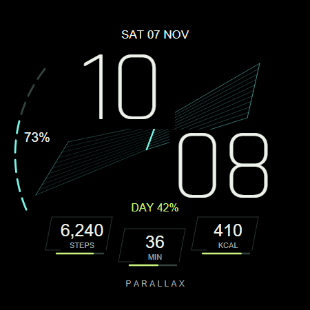

# PARALLAX

A futuristic digital face for **Wear OS 6 / API 36 and later**, built from scratch
on the Emberphase project and its optional health companions. Native Watch Face
Format 4; the face APK contains resources and no executable DEX code.

**Installed and active on the Watch6 Classic. Local validation and active/ambient
smoke checks passed; extended device acceptance remains open.** See [stage progress](docs/design/progress.md).



Open the [interactive review gallery](docs/previews/index.html) locally in a
browser to change the clock time, data, accent, battery state, and active/ambient
mode. Preview values are samples; browser rendering approximates Wear OS.
See [always on](docs/previews/ambient.png), [alternate data](docs/previews/alternate.png),
[low battery](docs/previews/low-battery.png), and [360 px](docs/previews/small.png).

## Behavior

* Offset geometric time numerals with the Day Fold graphics layered above them,
  a local date, and an interrupted battery rail.
* The **Day Fold** is native line geometry that changes once per minute. Its
  crease follows local wall-clock progress through a nominal 24-hour day,
  including skipped/repeated daylight-saving hours. It uses no sensor or network.
* Three independent user-selectable docks support short text, numeric ranges,
  goal progress, monochrome icons, and empty data. Provider text, titles, and tap
  actions stay with the selected provider. Missing readings show a dash.
* Defaults prefer installed Samsung steps and the existing companion's active
  minutes/kcal. Without those providers, use another installed source or leave
  docks empty. The face works independently of the companions.
* Editor controls: cyan/white/violet accent, Day Fold, signature, device/12/24-hour
  format, and outline/thin-solid always-on numerals.
* Ambient keeps time/date/battery and omits the fold, docks, rail, and signature.
  At 20% battery or less, the active fold rests and a battery warning appears.
  System power-saving companion integration awaits on-watch verification.

The existing phone/watch data bridge is retained. Watch companion **0.1.9** adds
MIN/KCAL titles to goal-progress data; older versions still supply values/goals
with a generic GOAL label. Phone companion **0.1.3** is unchanged. Read
[companion setup](docs/health-companion.md) and [data contracts](docs/data-sources.md)
for consent, pairing, expiry, and Samsung SDK requirements.

## Build and validate locally

Use Windows PowerShell, Node.js (tested with 24), Android Studio's JBR, Android
SDK Platform 36 / Build-Tools 36.0.0, and Chrome or Edge for previews. Set paths
for your installation, for example:

```powershell
$env:JAVA_HOME = "$env:LOCALAPPDATA\Programs\Android Studio\jbr"
$env:ANDROID_HOME = "$env:LOCALAPPDATA\Android\Sdk"
powershell.exe -NoProfile -ExecutionPolicy Bypass -File .\scripts\Build-WatchFace.ps1
.\gradlew.bat :health-watch:assembleDebug :health-watch:testDebugUnitTest :health-watch:lintDebug :health-common:testDebugUnitTest
powershell.exe -NoProfile -ExecutionPolicy Bypass -File .\scripts\Prepare-DeviceCandidate.ps1
```

The native build generates the face, runs checks, validates WFF, renders previews,
compiles/aligns/signs the APK, verifies its signature and contents, and checks
memory limits. Output: `artifacts/parallax-debug.apk`. Use `-SkipPreviews` to use
the committed picker image when no browser is available. Pinned validation tools
download on first use. No installation happens without an explicit install flag.

Alternatively, regenerate the native resources and use the Gradle build:

```powershell
node .\scripts\Generate-Parallax.mjs
.\gradlew.bat :watchface:verifyResourceOnlyDebug :watchface:lintDebug
```

Its APK is `watchface/build/outputs/apk/debug/watchface-debug.apk`. Both build paths
share the standard local Android debug key. Configure release signing before
public distribution. The phone/watch companions must retain matching application
IDs and signing certificates for paired-device Data Layer.

See [validation results and commands](docs/design/implementation-validation.md)
and [the pending device acceptance runbook](docs/design/device-acceptance.md).
The local candidate handoff contains both APKs and a checksummed `candidate.json`
under `artifacts/device-ready/`. Face 1.0.1/version code 40 and companion 0.1.9 have
been loaded onto the watch. Display offload remains an open issue; longer battery
testing and the rest of the physical acceptance matrix are still required.

## Source and design

The source scene is under `scripts/lib/parallax-scene.mjs`, with primitive,
complication, and editor modules beside it. `Generate-Parallax.mjs` writes
`watchface/src/main/res/raw/watchface.xml`; edit the source model and regenerate.
The preview renderer uses that same model. Meaningful geometry/data checks and
actual browser interaction tests are in `scripts/test-parallax.mjs` and
`scripts/Test-ParallaxPreview.mjs`.

Review the [design specification](docs/design/README.md),
[five-stage plan](docs/design/implementation-plan.md), and
[visual cleanup record](docs/design/cleanup.md). Existing application IDs remain
`com.bobbfwed.emberphase` and `com.bobbfwed.emberphase.health` for compatibility.

Project code retains the [MIT license](LICENSE). The bundled, unmodified Rajdhani
Light font has its own [SIL Open Font License](third-party/rajdhani/OFL.txt), also
included in the face APK and portable gallery. The proprietary Samsung Health
SDK is not included or relicensed.
