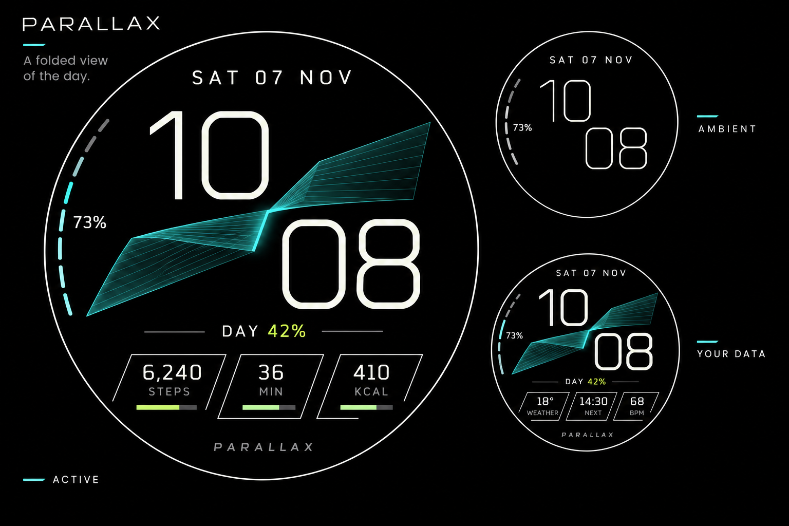

# Emberphase / PARALLAX design proposal

This Wear OS project is being redesigned from a clean visual starting point.
**The current deliverable is a design and implementation plan awaiting approval.**
The former watch-face layout, artwork, mockups, previews, visual generators, and
layout-specific checks have been removed. There is intentionally no buildable
watch face at this stage. No replacement face has been implemented or installed.

Review the [design specification](docs/design/README.md),
[implementation plan](docs/design/implementation-plan.md), and
[cleanup record](docs/design/cleanup.md). PARALLAX is a proposed display name;
existing application IDs and companion identities remain in place.

## Preserved foundation

* Android/Gradle project and resource-only Watch Face Format 4 module scaffolding,
  targeting Wear OS 6 / API 36 and later.
* `health-common`, `health-phone`, and `health-watch`: the existing Samsung Health
  bridge, cache, complication providers, and their tests.
* [Companion setup and limitations](docs/health-companion.md),
  [data contracts](docs/data-sources.md), and
  [recorded provider findings](docs/device-providers.md).
* Android SDK setup, provider inspection, WFF validation tools, and build/signing
  infrastructure. `scripts/Build-WatchFace.ps1` stops with a design-stage message
  until a replacement `watchface.xml` exists.

The companion can be developed independently. Its Samsung Health SDK import and
matching phone/watch application IDs and signing certificates are still required;
see the companion guide. New-face compatibility and appearance have not been
tested on a watch.

The project retains its [MIT license](LICENSE). The proprietary Samsung Health
SDK is not included or relicensed.
