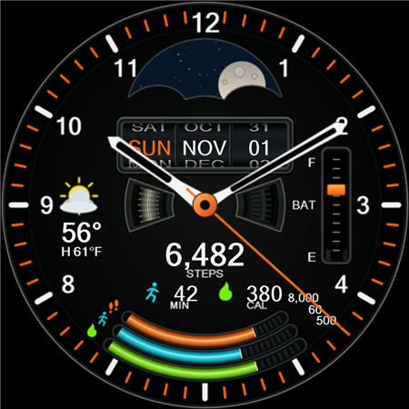

# Emberphase

Emberphase is an open-source mechanical-style analog watch face for **Wear OS 6
(Android API 36) and later**. Build it for your watch, customize the design, or
fork it to create your own version.

The face is hand-written in native Watch Face Format 4. Its resource-only APK
contains no executable app code. Wear OS scales the circular 450-unit layout
to the watch display.



## Features

* Skeleton analog hands and an optional mechanical second hand with a brief
  overshoot on each tick.
* An optional hidden balance rim glimpsed through two curved inner openings,
  alternating left and right once per second.
* A center-hub tap runs a six-second mechanical sweep, then settles onto the
  live time, date and indicators. Requires the Emberphase Health watch companion.
* A rotating twin-moon disc behind a recessed aperture.
* Mechanical calendar drums showing **weekday, month, date**, with partially
  visible adjacent entries.
* A battery slider with steady low-battery indicators.
* Weather showing current temperature, daily high, and conditions, or a
  customizable complication in the same inset.
* Three concentric activity tracks for steps, active minutes, and activity
  calories, with metallic fills, sharp edges, and exposed rack teeth.
* A simplified always-on display with orange hands, calendar, and battery
  gauge, plus white hour markers on black.

The design prioritizes battery efficiency through static artwork, native WFF
rendering, and provider-driven data updates. Seconds and the balance disappear
in always-on mode and at 15% battery or below; each has its own editor toggle. Battery-life
measurements are still pending.

See the balance in motion: [full-face animation](docs/previews/balance-motion.gif)
and [enlarged detail](docs/previews/balance-detail.gif). These previews hold the
clock hands still to isolate the mechanism's 220 ms movement and 780 ms rest.
The seconds hand retains its separate 130 ms tick.

Try the [interactive mechanical sweep preview](docs/previews/mechanical-sweep.html)
by downloading it and opening it in a browser. It is a standalone file with
sample weather/activity data. See [center-tap setup and behavior](docs/mechanical-sweep.md).

See the [always-on](docs/previews/ambient.png),
[low-battery](docs/previews/low-battery.png),
[always-on low-battery](docs/previews/ambient-low-battery.png), and
[unavailable-data](docs/previews/unavailable.png) previews. These are illustrative
artwork composites with sample data, not device screenshots. The design references
are the [original mockup](Mockup%20Images/Original%20Mockup.png) and
[always-on mockup](Mockup%20Images/Always%20On%20Original%20Mockup.png).

## Compatibility and current limitations

The project requires Wear OS 6 / API 36 or later. It has been tested on a
**Samsung Galaxy Watch6 Classic SM-R950 running Wear OS 6**, including active
and always-on rendering, live steps, and native weather. Other watches and
sizes have not yet been verified. See the
[device test results](docs/device-acceptance.md) for details and outstanding checks.

Activity data depends on the complication providers installed on the watch.
Steps prefer Samsung Health's steps-and-goal provider when available, with the
system step-count provider as a fallback. Active minutes and activity calories
use the optional **Emberphase Health** phone/watch companion, because the tested
Samsung Health watch app does not expose individual numeric providers for them.
The companion reads Samsung Health's totals and daily goals with permission.
Without the companion and consent, these displays remain `—`.
See [companion setup and current testing status](docs/health-companion.md).

The moon disc uses an offline date-based approximation of the lunar cycle,
advancing twice a day at midnight and noon UTC. Its mechanical aperture gives
a stylized view of the phase. See [the calculation and accuracy limits](docs/moon-phase.md).

## Build from source

The supplied build and artwork-generation scripts use **Windows PowerShell**.
Install Git and Android Studio, then use Android Studio's SDK Manager to install:

* Android SDK Platform 36.
* Android SDK Build-Tools 36.0.0.
* Android SDK Platform-Tools, including ADB.

Clone the repository, or clone your fork if you plan to publish your changes:

```powershell
git clone https://github.com/bobbfwed/Emberphase.git
cd Emberphase
```

Set `ANDROID_HOME` to your Android SDK directory and `JAVA_HOME` to Android
Studio's bundled `jbr` directory. For example, in the current PowerShell session:

```powershell
$env:ANDROID_HOME = "$env:LOCALAPPDATA\Android\Sdk"
# Adjust this to match your Android Studio installation.
$env:JAVA_HOME = 'C:\Program Files\Android\Android Studio\jbr'
```

The build script also checks saved user environment variables and standard
per-user Android Studio installation paths. An internet connection is needed
for validation-tool downloads on the first build.

Run the SDK-native build:

```powershell
powershell.exe -NoProfile -ExecutionPolicy Bypass -File .\scripts\Build-WatchFace.ps1
```

This validates the WFF schema, regenerates artwork and previews, compiles the
resources, debug-signs the APK, checks memory limits, and verifies that the APK
contains no DEX code. The output is **`artifacts/emberphase-debug.apk`**.

Alternatively, open the repository in Android Studio or use the Gradle wrapper:

```powershell
.\gradlew.bat :watchface:verifyResourceOnlyDebug :watchface:lintDebug
```

The Gradle build uses the committed artwork. Its APK is
`watchface/build/outputs/apk/debug/watchface-debug.apk`. Gradle 9.3.1 and Android
Gradle Plugin 9.1.1 are pinned in the project.

Both build paths use Android's standard local debug keystore. Configure release
signing before distributing a release build. Build output, local SDK settings,
and signing keys are ignored by Git.

## Install on your watch

1. Connect the computer and watch to the same Wi-Fi network.
2. Enable Developer options on the watch. On Galaxy Watch, open **Settings →
   About watch → Software information**, then tap **Software version** repeatedly
   until developer mode is enabled.
3. Open **Settings → Developer options**, enable **ADB debugging** and
   **Wireless debugging**, then select **Pair new device**.
4. Use the pairing address and code shown on the watch with the command below.
   After pairing, return to the main Wireless debugging screen and use its
   connection address. **The pairing and connection ports are different.**

Replace `WATCH_IP`, `PAIRING_PORT`, and `DEBUG_PORT` with the values displayed
on your watch:

```powershell
& "$env:ANDROID_HOME\platform-tools\adb.exe" pair WATCH_IP:PAIRING_PORT
& "$env:ANDROID_HOME\platform-tools\adb.exe" connect WATCH_IP:DEBUG_PORT
& "$env:ANDROID_HOME\platform-tools\adb.exe" devices -l
powershell.exe -NoProfile -ExecutionPolicy Bypass -File .\scripts\Build-WatchFace.ps1 -Install -Serial WATCH_IP:DEBUG_PORT
```

Enter the pairing code when prompted. Accept any debugging authorization prompt
on the watch. The install command requires an explicit device address or serial.

To install an APK you already built, use:

```powershell
& "$env:ANDROID_HOME\platform-tools\adb.exe" -s WATCH_IP:DEBUG_PORT install -r .\artifacts\emberphase-debug.apk
```

Long-press the current watch face, choose **Add watch face**, and select
**Emberphase**. Open its editor to configure the data sources, second hand,
and hidden balance.

## Customize the displays

Use **Left inset → Weather** for current temperature, today's high, and conditions
in the watch's temperature unit. Weather availability depends on the system
weather source; missing values show dashes, and `!` indicates available weather
with an error or stale-data state.

Choose **Left inset → Custom complication** to use an installed complication
provider instead, then select its source in the left inset.

For activity providers, select these areas in the watch-face editor:

| Display | Selection point |
| --- | --- |
| Steps | Large steps number |
| Active minutes | Number or dash above MIN |
| Activity calories | Number or dash above CAL |
| Custom left inset | Left weather area, after choosing Custom complication |

The activity values have separate, non-overlapping selection boxes. Tap the
number or dash for the metric you want to configure. Choose a provider that supplies the corresponding metric;
the face displays the provider's data and does not calculate activity totals.

Explicit goals are shown when a provider supplies `GOAL_PROGRESS` data.
For Samsung Health Steps, the enabled **Samsung Health steps target** editor
option also displays the range maximum as the target: this was compared with
the goal in Samsung Health on the tested watch. Disable this option if you
select a different steps provider whose range limit is not your personal goal.
Other `RANGED_VALUE` providers can fill a track, but their goal labels remain
`—`. A `SHORT_TEXT` provider
shows text without filling the track. System steps may differ from phone-merged
Samsung Health totals, and automatic Samsung Health goal synchronization has
not been verified.

Existing face instances can retain a range-based steps selection even when the
default requests `GOAL_PROGRESS`; the Samsung compatibility option handles that
case without reselection. For active minutes and calories, install and connect
the companion, then select **Emberphase · Active minutes** for MIN and
**Emberphase · Active calories** for CAL. New face instances prefer these
providers when installed; existing selections may need changing once. The combined
Samsung Health Daily Activity display cannot supply these numeric fields independently.

For the technical findings, see [data sources](docs/data-sources.md) and
[Samsung provider availability](docs/device-providers.md).

## Modify and validate

The main files to edit are:

| File | Purpose |
| --- | --- |
| `watchface/src/main/res/raw/watchface.xml` | Layout, expressions, hands, configuration, and complications |
| `scripts/New-DialAssets.ps1` | Reproducible static artwork |
| `scripts/New-Previews.ps1` | Illustrative previews and picker image |
| `watchface/src/main/res/values/strings.xml` | Watch-face and editor labels |
| `watchface/src/main/res/xml/watch_face_info.xml` | Picker and editor metadata |

After changing the artwork scripts, run the SDK-native build to regenerate the
assets. To regenerate just the artwork and previews:

```powershell
powershell.exe -NoProfile -ExecutionPolicy Bypass -File .\scripts\New-Previews.ps1
```

With Node.js installed, run the dependency-free expression and geometry checks:

```powershell
node .\scripts\test-watchface.mjs
node .\scripts\test-sweep.mjs
powershell.exe -NoProfile -ExecutionPolicy Bypass -File .\scripts\Test-BalanceWindows.ps1
```

The checks cover calendar rollover and leap years, activity ranges and goals,
battery bounds, the seconds and balance cutoffs, artwork references, selection
geometry, balance-window masking, and animated-preview timing.
The build additionally uses Google's WFF validator and memory checker, with
10 MiB active and 4 MiB ambient memory limits. See
[validation details](docs/validation.md) and the
[device test checklist](docs/device-acceptance.md) when testing a change.

To inspect complication provider declarations on a connected watch:

```powershell
powershell.exe -NoProfile -ExecutionPolicy Bypass -File .\scripts\Inspect-WatchProviders.ps1 -Serial WATCH_IP:DEBUG_PORT
```

The report is saved under the ignored `artifacts` directory. This inspection
reads device and provider declarations, not health records.

## Contribute

Fork the repository to make your own version. To propose an improvement, create
a branch in your fork and open a pull request against this repository's `main`
branch. Explain the change, include previews or watch screenshots for visual
changes, and describe the checks you ran. Pull requests are reviewed by the
maintainer before merging.

Bug reports are welcome through [GitHub Issues](https://github.com/bobbfwed/Emberphase/issues).
Include the watch model, Wear OS version, steps to reproduce, and the selected
complication provider when relevant.

## License

Emberphase is licensed under the [MIT License](LICENSE). You may use, modify,
and redistribute it, including commercially, with the required copyright and
license notices retained.
