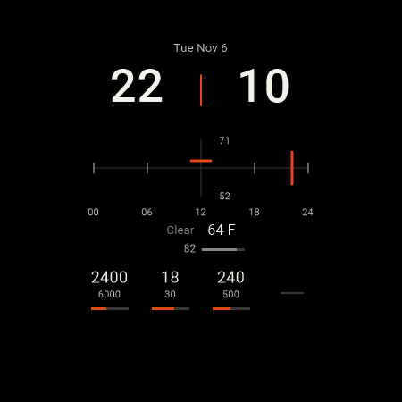
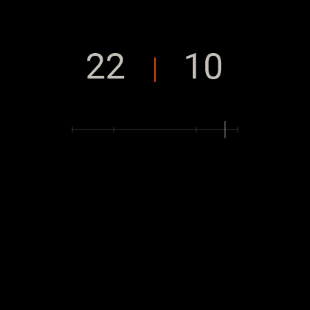

# Emberphase

Emberphase is an open-source watch face for **Wear OS 6 (Android API 36) and
later**, plus optional phone and watch companions that supply Samsung Health
activity totals.

The face is hand-written Watch Face Format 4. Its APK contains no executable
code. Wear OS scales a circular 450-unit layout to the round display. The
current scene is the Cinder Latch. Time is split hour and minute numerals
with a notch between them. A horizontal staff marks the local day, and one
vertical mark walks that staff from midnight to midnight. Weather, battery,
and four complication slots sit around that instrument. Always-on mode keeps
the numerals, the notch, the day staff, and the day mark.

These pictures are the design fixture at 22:10 in 24-hour time, drawn from
the scene. The interactive picture is the picker preview.

| Interactive | Always-on |
| :---: | :---: |
|  |  |

## What still exists

* Package `com.bobbfwed.emberphase` for the face, and
  `com.bobbfwed.emberphase.health` for both companions.
* Phone and watch companions that publish active minutes, active calories,
  their daily goals, a power-saving flag, and an optional tap timestamp.
* The data contracts in [docs/platform-constraints.md](docs/platform-constraints.md),
  [docs/data-sources.md](docs/data-sources.md), and
  [docs/device-providers.md](docs/device-providers.md).

The tested hardware is a **Samsung Galaxy Watch6 Classic SM-R950 running Wear
OS 6**, paired with a Galaxy S24 Ultra. Live steps and native weather were
observed on that watch through complication and WFF weather sources. See
[companion setup](docs/health-companion.md).

When battery life and motion conflict, choose battery life.

## Build from source

The build scripts use **Windows PowerShell**. Install Git and Android Studio,
then use Android Studio's SDK Manager to install:

* Android SDK Platform 36.
* Android SDK Build-Tools 36.0.0.
* Android SDK Platform-Tools, including ADB.

```powershell
git clone https://github.com/bobbfwed/Emberphase.git
cd Emberphase
```

Set `ANDROID_HOME` to your Android SDK directory and `JAVA_HOME` to Android
Studio's bundled `jbr` directory. For example, in the current PowerShell session:

```powershell
$env:ANDROID_HOME = "$env:LOCALAPPDATA\Android\Sdk"
# Adjust this to match your Android Studio installation.
$env:JAVA_HOME = 'C:\Program Files\Android\Android Studio\jbr'
```

The build script also checks saved user environment variables and standard
per-user Android Studio installation paths. An internet connection is needed
for validation-tool downloads on the first build.

```powershell
powershell.exe -NoProfile -ExecutionPolicy Bypass -File .\scripts\Build-WatchFace.ps1
```

This validates the WFF schema, compiles the resources, debug-signs the APK,
checks memory limits, and verifies that the APK contains no DEX code. The
output is **`artifacts/emberphase-debug.apk`**. The script stops if
`watchface.xml` is missing.

Alternatively, open the repository in Android Studio or use the Gradle wrapper:

```powershell
.\gradlew.bat :watchface:verifyResourceOnlyDebug :watchface:lintDebug
```

The Gradle APK is
`watchface/build/outputs/apk/debug/watchface-debug.apk`. Gradle 9.3.1 and
Android Gradle Plugin 9.1.1 are pinned in the project.

Both build paths use Android's standard local debug keystore. Configure release
signing before distributing a release build. Build output, local SDK settings,
and signing keys are ignored by Git.

## Install on your watch

1. Connect the computer and watch to the same Wi-Fi network.
2. Enable Developer options on the watch. On Galaxy Watch, open **Settings →
   About watch → Software information**, then tap **Software version** repeatedly
   until developer mode is enabled.
3. Open **Settings → Developer options**, enable **ADB debugging** and
   **Wireless debugging**, then select **Pair new device**.
4. Use the pairing address and code shown on the watch with the command below.
   After pairing, return to the main Wireless debugging screen and use its
   connection address. **The pairing and connection ports are different.**

Replace `WATCH_IP`, `PAIRING_PORT`, and `DEBUG_PORT` with the values displayed
on your watch:

```powershell
& "$env:ANDROID_HOME\platform-tools\adb.exe" pair WATCH_IP:PAIRING_PORT
& "$env:ANDROID_HOME\platform-tools\adb.exe" connect WATCH_IP:DEBUG_PORT
& "$env:ANDROID_HOME\platform-tools\adb.exe" devices -l
powershell.exe -NoProfile -ExecutionPolicy Bypass -File .\scripts\Build-WatchFace.ps1 -Install -Serial WATCH_IP:DEBUG_PORT
```

Enter the pairing code when prompted. Accept any debugging authorization prompt
on the watch. The install command requires an explicit device address or serial.

To install an APK you already built, use:

```powershell
& "$env:ANDROID_HOME\platform-tools\adb.exe" -s WATCH_IP:DEBUG_PORT install -r .\artifacts\emberphase-debug.apk
```

Long-press the current watch face, choose **Add watch face**, and select
**Emberphase**.

## Data sources

Activity data depends on the complication providers installed on the watch.
Steps prefer Samsung Health's steps provider when available. On the tested
watch, native WFF step fields returned zero while that provider returned live
steps. Active minutes and activity calories use the optional **Emberphase
Health** phone and watch companion, because the tested Samsung Health watch
app does not expose separate numeric providers for them. Without the companion
and consent, those readings stay unavailable. See
[companion setup](docs/health-companion.md).

A `GOAL_PROGRESS` payload supplies a value and a target. A `RANGED_VALUE`
payload supplies its own minimum and maximum; do not treat an arbitrary range
maximum as a personal goal. Samsung Health Steps on the tested watch was the
observed exception, and only when that compatibility is explicitly enabled.
`SHORT_TEXT` is text only. Empty data stays empty. The face does not calculate
activity totals.

Existing face instances can retain a previous provider selection after an
update. For minutes and calories, install and connect the companion, then
select **Emberphase · Active minutes** and **Emberphase · Active calories**.
The combined Samsung Health Daily Activity display cannot supply these numeric
fields independently.

See [data sources](docs/data-sources.md) and
[Samsung provider availability](docs/device-providers.md).

## Validate

The scene file is
`watchface/src/main/res/raw/watchface.xml`. Editor labels live in
`watchface/src/main/res/values/strings.xml`. Picker metadata lives in
`watchface/src/main/res/xml/watch_face_info.xml`.

The SDK build uses Google's WFF validator and memory checker, with 10 MiB
active and 4 MiB ambient limits. Expression strings in XML use `&quot;`.
Editor labels must not contain `%`, because Samsung formats them anyway.

To inspect complication provider declarations on a connected watch:

```powershell
powershell.exe -NoProfile -ExecutionPolicy Bypass -File .\scripts\Inspect-WatchProviders.ps1 -Serial WATCH_IP:DEBUG_PORT
```

The report is saved under the ignored `artifacts` directory. This inspection
reads device and provider declarations, not health records.

## Contribute

Fork the repository to make your own version. To propose an improvement, create
a branch in your fork and open a pull request against this repository's `main`
branch. Explain the change, include previews or watch screenshots for visual
changes, and describe the checks you ran. Pull requests are reviewed by the
maintainer before merging.

Bug reports are welcome through [GitHub Issues](https://github.com/bobbfwed/Emberphase/issues).
Include the watch model, Wear OS version, steps to reproduce, and the selected
complication provider when relevant.

## License

Emberphase is licensed under the [MIT License](LICENSE). You may use, modify,
and redistribute it, including commercially, with the required copyright and
license notices retained.
