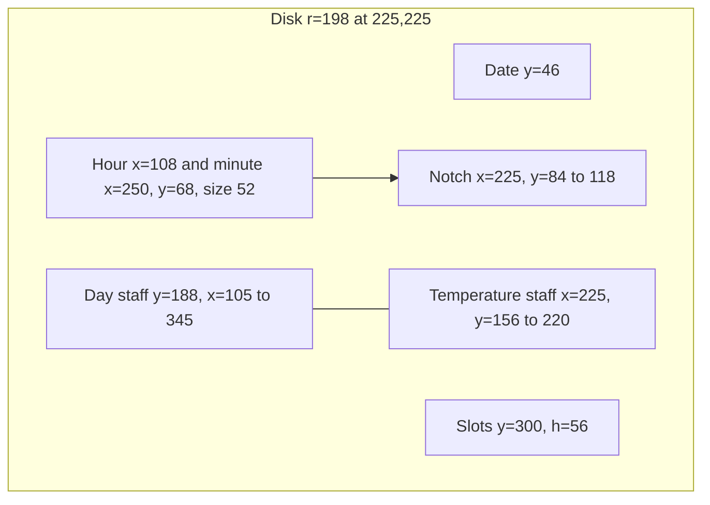
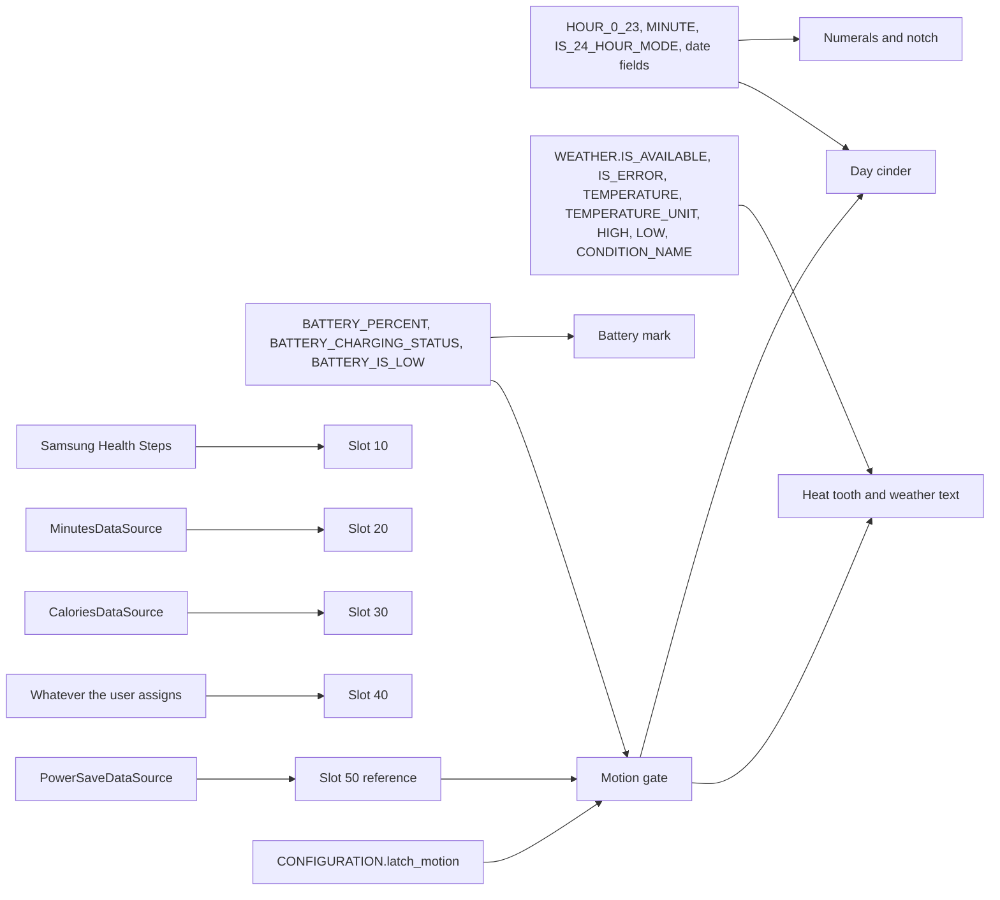
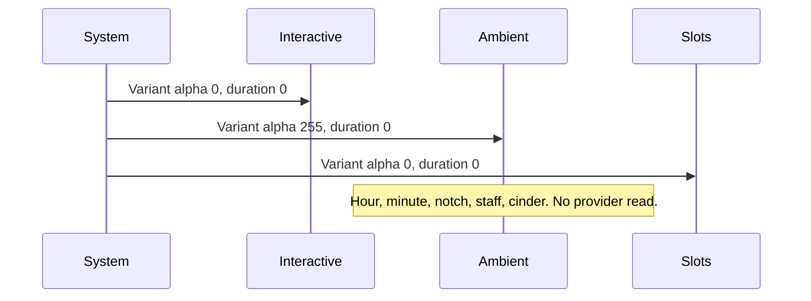

# Cinder Latch

| | |
| --- | --- |
| Author | TBD |
| Date | 2026-11-06 |
| Status | Draft |
| Face | `com.bobbfwed.emberphase`, Watch Face Format 4, API 36, resource-only |
| Device | Galaxy Watch6 Classic SM-R950, round, 480×480, scene 450×450 |
| Supersedes | The removed scene. This document does not recover it. |

## Overview

Emberphase needs a new watch face. The previous scene was removed on purpose, the resource-only build stops until `watchface/src/main/res/raw/watchface.xml` exists again, and the replacement has to be a composition this project has not already shipped: not an analog dial, not a digital stack, not a skeleton watch, not a moon window, not activity rings, and not a sports HUD.

The face is the **Cinder Latch**. Time is two large numerals split by a fixed notch, so 12-hour and 24-hour time are readable in under a second. The signature is a cross-staff under those numerals. A horizontal staff is the local civil day. One vertical ember, the day cinder, walks that staff from local midnight to the next local midnight. A vertical staff through the noon point is today's temperature span. One horizontal tooth walks that staff from today's low to today's high. Neither mark rotates. The day staff is also the midpoint of the temperature span, so the cross is one instrument rather than two widgets. `WEATHER.DAY_TEMPERATURE_LOW` is a real source and is not confirmed on this watch. The vertical staff, the tooth, and the high and low labels ship only after the acceptance check in the heat-tooth section. Current temperature, `WEATHER.TEMPERATURE_UNIT`, the condition name, and the stale dot do not wait on that check.

The face stays a resource-only WFF 4 document. Both companions stay on `com.bobbfwed.emberphase.health` with their current data contracts. The scene adds no phone health query, no sensor, and no companion change. `SweepDataSource` is not subscribed. Activity totals that depend on a provider are user complication slots. Time, the always-on treatment, the latch, battery, and native weather are drawn by the face.

## Background and motivation

`scripts/Build-WatchFace.ps1` throws before validation when `watchface/src/main/res/raw/watchface.xml` is absent. `watchface/build.gradle.kts` then refuses `verifyResourceOnlyDebug` if the packaged APK has no `res/raw/watchface.xml` or contains a `.dex`. The current package is still versionName `0.5.16`, versionCode `33`. The manifest already declares a code-free WFF 4 face:

```4:7:c:\Apps\Emberphase\watchface\src\main\AndroidManifest.xml
    <application android:label="@string/watch_face_name" android:hasCode="false">
        <meta-data android:name="com.google.android.wearable.standalone" android:value="true" />
        <property android:name="com.google.wear.watchface.format.version" android:value="4" />
    </application>
```

What remains, and must keep working, is the companion contract:

- Phone and watch apps share `com.bobbfwed.emberphase.health` and the Data Layer path `/emberphase/activity/v1`.
- `MinutesDataSource` and `CaloriesDataSource` publish `GOAL_PROGRESS` and `SHORT_TEXT`. A missing snapshot, a null metric, or an expired snapshot becomes `NoDataComplicationData`. A measured zero stays zero. Goals and totals expire at the earlier of three hours and local midnight.
- `PowerSaveDataSource` publishes `RANGED_VALUE` 0 or 1, with `UPDATE_PERIOD_SECONDS` 0. The slot that reads it must lie on the circular face or the runtime never activates it and the value stays 0.
- `SweepDataSource` is not subscribed. `SweepTiming.value` publishes `(milliseconds within the UTC day) + 1` for about six seconds (`DURATION_MS` is 6000). `RANGE_MAX` is 86,400,001. Zero is idle. That is not a general epoch timestamp, and this face does not retarget the channel.
- On this watch, native `STEP_COUNT` and `STEP_GOAL` returned 0 while Samsung Health Steps returned a live `RANGED_VALUE` whose maximum matched the Samsung Health goal. Samsung Daily Activity is not three numbers. Samsung Weather's complication is formatted text. The repo records native `WEATHER.TEMPERATURE`, `WEATHER.DAY_TEMPERATURE_HIGH`, `WEATHER.CONDITION`, `WEATHER.CONDITION_NAME`, `WEATHER.TEMPERATURE_UNIT`, `WEATHER.IS_AVAILABLE`, and `WEATHER.IS_ERROR` as the working weather fields. `WEATHER.DAY_TEMPERATURE_LOW` is a real version-2 source and is not confirmed on this watch.

`ActivityDataSource.render` is the payload the slots must display without reinterpretation:

```58:79:c:\Apps\Emberphase\health-watch\src\main\java\com\bobbfwed\emberphase\health\watch\ActivityDataSource.java
    private ComplicationData render(ComplicationType type, ActivitySnapshot.Metric metric, TimeRange validity) {
        if (metric.value == null) return new NoDataComplicationData();
        // ...
        if (type == ComplicationType.GOAL_PROGRESS && metric.hasProgress()) {
            GoalProgressComplicationData.Builder builder = new GoalProgressComplicationData.Builder(
                    metric.value.floatValue(), metric.goal.floatValue(), description).setText(text).setTapAction(tap);
            // ...
        }
        if (type == ComplicationType.SHORT_TEXT) {
            ShortTextComplicationData.Builder builder = new ShortTextComplicationData.Builder(text, description)
                    .setTitle(new PlainComplicationText.Builder(isMinutes() ? "MIN" : "KCAL").build()).setTapAction(tap);
```

`Metric` rejects `goal <= 0` in its constructor, so a stored goal of zero cannot occur. `hasProgress()` is `value != null && goal != null`. `render` returns `NoDataComplicationData` when `metric.value` is null, and again when the requested type is `GOAL_PROGRESS` and `hasProgress()` is false. It builds `SHORT_TEXT` only when the requested type is already `SHORT_TEXT`. The slot's secondary policy type is not a per-update fallback. A null goal while the slot remains on `GOAL_PROGRESS` is therefore the empty hairline, and the known total is hidden. That is existing companion behavior. The face does not invent a zero to fill the gap. A measured 0 with a positive target still shows `0`. `GOAL_PROGRESS` may exceed its target. The face clamps only the drawn fraction.

## Goals and non-goals

### Goals

- A 450-unit scene, `clipShape="CIRCLE"`, center (225, 225), that an engineer can implement from this document alone.
- Time readable in under a second in both 12-hour and 24-hour mode, including in ambient, without complication data.
- One signature instrument, the Cinder Latch, computed from WFF clock fields and native `WEATHER.*` only.
- Battery drawn from `BATTERY_PERCENT` and `BATTERY_CHARGING_STATUS`.
- Four user slots and one non-editable power-save slot. User slots do not overlap.
- Empty, unavailable, and stale states that never draw a fabricated zero for health or weather. Unavailable weather draws `--` and one unknown mark.
- An ambient scene whose non-black pixel count inside the circle is at most 4,771 (3.0 percent of π×225²).
- Active memory under 10 MiB and ambient memory under 4 MiB, with the validator report text checked, not only its exit code.
- No `%` in any `strings.xml` value.

### Non-goals

- No analog hands, digital colon stack, skeleton movement, moon phase, concentric activity rings, or sports-HUD rings. `MOON_PHASE_POSITION` and `MOON_PHASE_TYPE` are not read.
- No `STEP_COUNT`, `STEP_GOAL`, `STEP_PERCENT`, `HEART_RATE`, accelerometer, gyroscope, or GPS source.
- No `DigitalClock` or `AnalogClock` element. Those are the ordinary faces this design is not.
- No continuous animation, no `Animation repeat="-1"`, and no reference to `SECOND`, `MILLISECOND`, `SECOND_MILLISECOND`, or `SECONDS_IN_DAY`. A per-second source would wake the face for a sub-pixel move of the cinder (240/86400 units per second).
- No use of `SweepDataSource`, `SweepReceiver`, or `SweepTiming`. No health-watch or health-phone change.
- No parsing of Samsung Daily Activity or Samsung Weather complication text into numbers.
- No photo-fill slot, no weighted-element chart, no flavor, no user color theme, no custom font file.
- No second accent. Over-goal progress does not introduce a new color.

## Proposed design

### What a watchmaker is looking at

The Cinder Latch is a cross-staff, not a dial.

The horizontal member is a day staff 240 units long. Its left stop is local midnight and its right stop is the next local midnight. Five marks sit on it: `00`, `06`, `12`, `18`, and `24`. The `24` mark is the right-hand stop, not a twenty-fifth hour. At 00:00 the cinder is on `00`. At 23:59 it is one minute short of `24`. The staff does not flip in 12-hour mode. A 12-hour staff would put 10:00 AM and 10:00 PM on the same point, and the cinder would lie. 12-hour mode changes only the numerals and the AM/PM label.

The vertical member is a temperature staff 64 units tall, fixed through the noon point of the day staff, when the daily-low check has passed. Its top is today's high. Its bottom is today's low. The day staff is exactly halfway along it, so a tooth above the day staff means the current temperature is above the midpoint of today's range. When that check has passed, the tooth is omitted when weather is unavailable or the day's high is not greater than the day's low. The high and low numbers are not omitted just because the span is zero. When the check has not passed, the temperature staff, the tooth, and both labels are absent, and the day staff stands alone.

Three ember-colored marks are distinct by orientation:

| Mark | Moves | Geometry | Meaning |
| --- | --- | --- | --- |
| Notch | No | Vertical, 2×34, between the hour and the minute | Separator. Not data. |
| Day cinder | Yes, along the day staff | Vertical, 3×36, centered on the staff | Fraction of the local civil day. |
| Heat tooth | Yes, along the temperature staff | Horizontal, 22×3, centered on the staff | Current temperature inside today's low and high. |

The cinder is not a minute hand. Its minute step is 240/1440 = 0.167 units. Reading minutes off it would fail the one-second test. The numerals do that job. The cinder answers "how far has today burned," which is the phase in Emberphase. It is not a moon.

This is not a common watch-face pattern. A common face moves by rotation around the center, or it stacks glyphs and rings. These two riders translate on straight axes, the axes do not encode the same quantity, and one axis is the midpoint of the other. Nothing here is a pinion, a moon aperture, or a progress ring.

### Scene, clip, and safe disk

```xml
<WatchFace width="450" height="450" clipShape="CIRCLE">
```

`clipShape` defaults to `CIRCLE`, but the document sets it. The physical rotating bezel is not a WFF input. Primary content, including every complication corner, stays inside the disk of radius 198 centered at (225, 225). That is 27 scene units of margin, about 29 device pixels once 450 units are scaled onto 480. The farthest user-slot corner in this layout is radius 185.3. The farthest time-glyph corner is radius 195.8.

No element uses `Gyro`. The face does not read the bezel.

### Color

One accent, a black field, and a short neutral scale. Every color below is opaque. Write them as 8-digit ARGB in XML (`#fff4f1ea`), never as a translucent gray that looks like a large dim fill.

| Role | Hex | Used for |
| --- | --- | --- |
| Field | `#000000` | `Scene backgroundColor` in both modes |
| Primary | `#F4F1EA` | Hour, minute, current temperature, slot value, charging battery |
| Secondary | `#C4C0B8` | Date, AM/PM, staff labels, high, low, ticks, slot target, ambient numerals |
| Tertiary | `#8A8680` | Condition name, stale tooth, stale dot, unknown mark |
| Structure | `#3A3834` | Staffs, battery track, goal track, empty hairline |
| Accent | `#E24B16` | Notch, day cinder, fresh heat tooth, low-battery mark, goal fill |

`#F4F1EA` on `#000000` is the sunlight pair for the time. Secondary text is at least 11 scene units and is not the accent. The accent is reserved for marks and for the goal fill, not for a rainbow of slot colors. Provider color ramps are ignored.

Approximate contrast, primary on black, is about 18:1. Secondary `#C4C0B8` on black is about 12:1. Tertiary `#8A8680` on black is about 6:1 and is used only for the condition name, which is allowed to ellipsize.

### Layout

Scene order is paint order. Later elements paint above earlier ones. The regions below do not overlap, and the numerals are still the last children of the interactive group so they stay above the latch.

Every full-scene `Group` in this design is `x="0" y="0" width="450" height="450"`. A child of that group keeps scene coordinates. A shape's `x` and `y` are local to its `PartDraw`. `PartDraw` `x`, `y`, `width`, and `height` are integers. A `PartDraw` clips its children, so each box below includes the stroke's cap overflow and is not wrapped around the midnight position only.

`Line`, `Rectangle`, and `Ellipse` are children of `PartDraw`. They are not children of `Scene` or `Group`. `Condition` requires an `Expressions` child. Each `Compare` and each `Default` has exactly one child. Sibling `Compare` elements are not if/else: a true expression stays visible even when another is also true, and `Default` runs only when every `Compare` is false. Expressions that could overlap are written so only one is true, or the second test is a nested `Condition`. `Compare expression` is the `Expression` `name`, not an inline formula.

On every `PartText`, `align`, `ellipsis`, `maxLines`, and `isAutoSize` belong on `Text`. `family`, `size`, `weight`, `slant`, `letterSpacing`, and `color` belong on `Font`. `letterSpacing` is in ems. `isAutoSize` is version 3, floors at 12, and is used only on slot values. `minSize`, `verticalAlign`, and `lineSpacing` are version 5 and are not used. Inside an attribute, a quote is written `&quot;`. Expressions in `CDATA` keep literal quotes. A `Template` may contain `%s`. That placeholder is not a `strings.xml` value.

#### Interactive group

`Group name="interactive" x="0" y="0" width="450" height="450"`.

```xml
<Variant mode="AMBIENT" target="alpha" value="0" duration="0.0" />
```

`duration="0.0"` disables the version-4 ambient transition. The default duration is `1.0`, which animates the whole scene on every always-on change. That costs battery and fights Samsung display offload.

Children, in paint order:

| Z | Element | Scene box | Node | Color | Source or literal |
| --- | --- | --- | --- | --- | --- |
| 1 | Date | 145, 46, 160, 18 | `PartText`. `Text align="CENTER" maxLines="1"`. `Font` size 13, weight `NORMAL` | `#C4C0B8` | `DAY_OF_WEEK_S`, `MONTH_S`, `DAY` |
| 2 | Battery | number 180, 272, 42, 16; track 226, 278, 48, 3 | `Group name="battery"`. See Battery | see battery | `BATTERY_PERCENT`, `BATTERY_CHARGING_STATUS` |
| 3 | Day staff | line (105, 188)–(345, 188) | `PartDraw name="day_staff"` 104, 187, 242, 3 | `#3A3834` | none |
| 4 | Day ticks | x = 105, 165, 285, 345; y = 182 to 194 | `PartDraw name="day_ticks"` 104, 181, 242, 14 | `#C4C0B8` | none |
| 5 | Staff labels | y=232, h=14, w=26 | `Group name="staff_labels"`, five `PartText` | `#C4C0B8` | literals `00` `06` `12` `18` `24` |
| 6 | Temperature staff | line (225, 156)–(225, 220) | `PartDraw name="temperature_staff"` 224, 155, 3, 66 | `#3A3834` | none. Deleted if the daily-low check fails |
| 7 | Weather, tooth | see Weather text and Heat tooth | `Group name="weather"` | see those sections | `WEATHER.*` |
| 8 | Day cinder | line y=170 to 206, x from the civil day | `Group name="day_cinder"` | `#E24B16` | `HOUR_0_23`, `MINUTE` |
| 9 | Hour, minute, notch, AM/PM | see the 12/24 section | `Group name="time"` | `#F4F1EA`, notch `#E24B16` | `IS_24_HOUR_MODE` |

There is no center tick. The temperature staff is the noon mark when it is in the scene.

Staff-label boxes, centered on the ticks: `00` at x=92, `06` at x=152, `12` at x=212, `18` at x=272, `24` at x=332. All y=232, w=26, h=14. Each is a `PartText` with `Text align="CENTER" maxLines="1"` and `Font family="SYNC_TO_DEVICE" size="11" weight="NORMAL" color="#ffc4c0b8"`. The `Font` character data is the literal. No `Parameter`.

The gap between the hour box (ends x=200) and the minute box (starts x=250) is 50 units. The notch at x=225 sits in that gap. It is not a colon glyph. `AMPM_POSITION` is not followed. A locale that wants AM before the hour would move the hour box; the notch has to stay between the two numbers. The screen reader still identifies the block as time.

Font for every `PartText`: `family="SYNC_TO_DEVICE"`, `slant="NORMAL"`, `weight="NORMAL"` except the hour and minute, which use `weight="MEDIUM"`. No file under `res/font`. No rendered string contains a percent sign. Battery is digits only.

#### Screen readers

`ScreenReader` is a child of a group, a part, or a `ComplicationSlot`. `stringId` is the bare resource name. One node carries each id:

| stringId | Node |
| --- | --- |
| `reader_time` | `Group name="time"` in the interactive scene, and `Group name="ambient_time"` |
| `reader_day` | `Group name="day_cinder"`, and `PartDraw name="ambient_cinder"` |
| `reader_weather` | `Group name="weather"` |
| `reader_battery` | `Group name="battery"` |
| `reader_empty` | `Group name="slot_empty"` inside each user slot's `EMPTY` complication. Not slot 50 |
| `reader_steps` | `ComplicationSlot slotId="10"` |

#### Static strokes

Thickness 1 with cap `BUTT` overflows by 0.5 on each side and not past the endpoints. Thickness 2 or 3 with cap `ROUND` overflows by half the thickness past the endpoints and on each side.

```xml
<PartDraw x="104" y="187" width="242" height="3" name="day_staff">
    <Line startX="1" startY="1" endX="241" endY="1">
        <Stroke color="#ff3a3834" thickness="1" cap="BUTT" />
    </Line>
</PartDraw>
<PartDraw x="104" y="181" width="242" height="14" name="day_ticks">
    <Line startX="1" startY="1" endX="1" endY="13">
        <Stroke color="#ffc4c0b8" thickness="1" cap="BUTT" />
    </Line>
    <Line startX="61" startY="1" endX="61" endY="13">
        <Stroke color="#ffc4c0b8" thickness="1" cap="BUTT" />
    </Line>
    <Line startX="181" startY="1" endX="181" endY="13">
        <Stroke color="#ffc4c0b8" thickness="1" cap="BUTT" />
    </Line>
    <Line startX="241" startY="1" endX="241" endY="13">
        <Stroke color="#ffc4c0b8" thickness="1" cap="BUTT" />
    </Line>
</PartDraw>
<PartDraw x="224" y="155" width="3" height="66" name="temperature_staff">
    <Line startX="1" startY="1" endX="1" endY="65">
        <Stroke color="#ff3a3834" thickness="1" cap="BUTT" />
    </Line>
</PartDraw>
```

The day-staff local line is scene (105, 188)–(345, 188). The tick local lines are scene x = 105, 165, 285, 345 and scene y = 182 to 194. The temperature-staff local line is scene (225, 156)–(225, 220). Delete `temperature_staff` with the tooth and the high and low labels when the daily-low check fails. The day staff and the ticks stay.

There is no center tick. The temperature staff is the noon mark.

Staff-label boxes, centered on the ticks: `00` at x=92, `06` at x=152, `12` at x=212, `18` at x=272, `24` at x=332. All y=232, w=26, h=14.

The gap between the hour box (ends x=200) and the minute box (starts x=250) is 50 units. The notch at x=225 sits in that gap. It is not a colon glyph. `AMPM_POSITION` is not followed. A locale that wants AM before the hour would move the hour box; the notch has to stay between the two numbers. The screen reader still identifies the block as time.

Font for every `PartText`: `family="SYNC_TO_DEVICE"`, `slant="NORMAL"`, `weight="NORMAL"` except the hour and minute, which use `weight="MEDIUM"`. No file under `res/font`. No `minSize` attribute: that attribute is WFF version 5. `isAutoSize` is version 3 and is used only on slot values, where the implicit floor is 12. Do not set `verticalAlign` or `lineSpacing`; those are version 5 text attributes.

`Text` templates use `%s` inside the XML. That placeholder is not a user-visible string and must not be stripped. The ban on `%` applies to `strings.xml` and to any literal text the user reads. No rendered string contains a percent sign. Battery is digits only.

#### Day cinder

The cinder is not inside the 12/24 `Condition`. It always uses `HOUR_0_23` and `MINUTE`, in both hour modes. `Group name="day_cinder"` carries `ScreenReader stringId="reader_day"` and one `Condition`. The moving branch and the static branch are each one `PartDraw`. `Animation` is a child of each `Transform` in the moving branch only.

`PartDraw x="103" y="168" width="244" height="40"` covers scene x = 103 through 347 and y = 168 through 208. The local line from (2, 2) to (2, 38) is the scene segment (105, 170)–(105, 206). Both endpoint transforms are:

```text
2 + (([HOUR_0_23] * 60 + [MINUTE]) / 1440) * 240
```

Checked scene x, which is 103 plus that local x:

| Local time | Minutes into the day | Cinder x |
| --- | --- | --- |
| 00:00 | 0 | 105 |
| 06:00 | 360 | 165 |
| 12:00 | 720 | 225 |
| 18:00 | 1080 | 285 |
| 22:10 | 1330 | 326.67 |
| 23:59 | 1439 | 344.83 |

A round cap of thickness 3 adds 1.5 past each end. At 00:00 the left cap is scene x = 103.5. At 23:59 the right cap is scene x = 346.33. The top cap is scene y = 168.5 and the bottom cap is scene y = 207.5. All four stay inside the `PartDraw`.

```xml
<Group x="0" y="0" width="450" height="450" name="day_cinder">
    <ScreenReader stringId="reader_day" />
    <Condition>
        <Expressions>
            <Expression name="cinder_moves"><![CDATA[[CONFIGURATION.latch_motion] == "TRUE" && [BATTERY_PERCENT] > 20 && [REFERENCE.power_saving] == 0 && ![BATTERY_IS_LOW]]]></Expression>
        </Expressions>
        <Compare expression="cinder_moves">
            <PartDraw x="103" y="168" width="244" height="40" name="cinder_moves">
                <Line startX="2" startY="2" endX="2" endY="38">
                    <Stroke color="#ffe24b16" thickness="3" cap="ROUND" />
                    <Transform target="startX" value="2 + (([HOUR_0_23] * 60 + [MINUTE]) / 1440) * 240">
                        <Animation duration="0.2" fps="15" interpolation="EASE_OUT" repeat="0" />
                    </Transform>
                    <Transform target="endX" value="2 + (([HOUR_0_23] * 60 + [MINUTE]) / 1440) * 240">
                        <Animation duration="0.2" fps="15" interpolation="EASE_OUT" repeat="0" />
                    </Transform>
                </Line>
            </PartDraw>
        </Compare>
        <Default>
            <PartDraw x="103" y="168" width="244" height="40" name="cinder_static">
                <Line startX="2" startY="2" endX="2" endY="38">
                    <Stroke color="#ffe24b16" thickness="3" cap="ROUND" />
                    <Transform target="startX" value="2 + (([HOUR_0_23] * 60 + [MINUTE]) / 1440) * 240" />
                    <Transform target="endX" value="2 + (([HOUR_0_23] * 60 + [MINUTE]) / 1440) * 240" />
                </Line>
            </PartDraw>
        </Default>
    </Condition>
</Group>
```

`Default` is the same geometry with no `Animation`. Until PR 4 adds `latch_motion`, the group holds only `cinder_static`. Ambient never contains this group.

At noon the cinder lies on the temperature staff, when that staff is present. The cinder is 3 units thick and the staff is 1, so the ember remains the rider. Draw the staffs first and the cinder after the tooth. The tooth is 22 units wide, so when they cross it remains visible on both sides of the cinder.

#### Heat tooth

`WEATHER.DAY_TEMPERATURE_LOW` is a version-2 source. This repo has not recorded it on the SM-R950. `WEATHER.TEMPERATURE`, `WEATHER.DAY_TEMPERATURE_HIGH`, `WEATHER.CONDITION`, `WEATHER.CONDITION_NAME`, `WEATHER.TEMPERATURE_UNIT`, `WEATHER.IS_AVAILABLE`, and `WEATHER.IS_ERROR` are the fields the repo records as working. A genuine low of 0 is a valid reading, so the running face cannot treat 0 as missing. If this firmware leaves the low at 0 while `WEATHER.IS_AVAILABLE` is true, `HIGH > LOW` succeeds for any positive high, the low label would draw a fabricated 0, and the tooth would be scaled across a false range.

Acceptance check, before the tooth is called done: a non-zero daily low shown by Samsung Weather matches `WEATHER.DAY_TEMPERATURE_LOW` on the SM-R950. If the check passes, ship the XML in this section. If it fails, delete `PartDraw name="temperature_staff"`, this tooth `Condition`, and both high and low `PartText` elements. Keep the current temperature, `WEATHER.TEMPERATURE_UNIT`, `WEATHER.CONDITION_NAME`, the stale dot, and the unknown mark. Do not add a runtime test that hides a low of 0.

Draw the tooth only when weather is available and today's high is strictly greater than today's low. WFF evaluates `x / 0` as 0, which would park a tooth on the low stop and look like a real reading. The guard is structural: the `Line` exists only inside the true `Compare`, not behind a ternary that still divides.

`PartDraw x="212" y="154" width="26" height="68"` covers scene x = 212 through 238 and y = 154 through 222. The local line from (2, 66) to (24, 66) is the low stop, scene (214, 220)–(236, 220). Both `startY` and `endY` use:

```text
66 - clamp(([WEATHER.TEMPERATURE] - [WEATHER.DAY_TEMPERATURE_LOW]) / ([WEATHER.DAY_TEMPERATURE_HIGH] - [WEATHER.DAY_TEMPERATURE_LOW]), 0, 1) * 64
```

`clamp` is the WFF version-1 function. Clamp the drawn fraction only. Fraction 0 is local y = 66, scene y = 220. Fraction 1 is local y = 2, scene y = 156. Fraction 0.5 is scene y = 188, the day staff, because the staff is the midpoint of the 64-unit span. A current temperature of 64 with a low of 52 and a high of 71 is fraction 12/19, local y = 25.58, scene y = 179.58. If the current temperature is outside today's reported range, the tooth sits on the nearer end and the numeric temperature still shows the unclamped value.

A round cap of thickness 3 adds 1.5 around the segment. At the high stop the cap reaches scene y = 154.5. At the low stop it reaches scene y = 221.5. The left cap reaches scene x = 212.5 and the right cap reaches scene x = 237.5. The box holds that travel.

`heat_fresh` and `heat_stale` exclude each other. Each color `Compare` has one child, a nested `Condition`, because a moving `Compare` beside a static `Compare` would leave both true whenever the gate is open. The nested `Default` is the static tooth. `Animation` is on the two `Transform` elements of the moving `PartDraw` only. The stale `PartDraw` elements are the same XML with `name` set to `tooth_stale_moves` or `tooth_stale` and stroke `#ff8a8680`. This `Condition` is the last child of `Group name="weather"`.

```xml
<Condition>
    <Expressions>
        <Expression name="heat_fresh"><![CDATA[[WEATHER.IS_AVAILABLE] && [WEATHER.DAY_TEMPERATURE_HIGH] > [WEATHER.DAY_TEMPERATURE_LOW] && ![WEATHER.IS_ERROR]]]></Expression>
        <Expression name="heat_stale"><![CDATA[[WEATHER.IS_AVAILABLE] && [WEATHER.DAY_TEMPERATURE_HIGH] > [WEATHER.DAY_TEMPERATURE_LOW] && [WEATHER.IS_ERROR]]]></Expression>
    </Expressions>
    <Compare expression="heat_fresh">
        <Condition>
            <Expressions>
                <Expression name="tooth_moves"><![CDATA[[CONFIGURATION.latch_motion] == "TRUE" && [BATTERY_PERCENT] > 20 && [REFERENCE.power_saving] == 0 && ![BATTERY_IS_LOW]]]></Expression>
            </Expressions>
            <Compare expression="tooth_moves">
                <PartDraw x="212" y="154" width="26" height="68" name="tooth_fresh_moves">
                    <Line startX="2" startY="66" endX="24" endY="66">
                        <Stroke color="#ffe24b16" thickness="3" cap="ROUND" />
                        <Transform target="startY" value="66 - clamp(([WEATHER.TEMPERATURE] - [WEATHER.DAY_TEMPERATURE_LOW]) / ([WEATHER.DAY_TEMPERATURE_HIGH] - [WEATHER.DAY_TEMPERATURE_LOW]), 0, 1) * 64">
                            <Animation duration="0.2" fps="15" interpolation="EASE_OUT" repeat="0" />
                        </Transform>
                        <Transform target="endY" value="66 - clamp(([WEATHER.TEMPERATURE] - [WEATHER.DAY_TEMPERATURE_LOW]) / ([WEATHER.DAY_TEMPERATURE_HIGH] - [WEATHER.DAY_TEMPERATURE_LOW]), 0, 1) * 64">
                            <Animation duration="0.2" fps="15" interpolation="EASE_OUT" repeat="0" />
                        </Transform>
                    </Line>
                </PartDraw>
            </Compare>
            <Default>
                <PartDraw x="212" y="154" width="26" height="68" name="tooth_fresh">
                    <Line startX="2" startY="66" endX="24" endY="66">
                        <Stroke color="#ffe24b16" thickness="3" cap="ROUND" />
                        <Transform target="startY" value="66 - clamp(([WEATHER.TEMPERATURE] - [WEATHER.DAY_TEMPERATURE_LOW]) / ([WEATHER.DAY_TEMPERATURE_HIGH] - [WEATHER.DAY_TEMPERATURE_LOW]), 0, 1) * 64" />
                        <Transform target="endY" value="66 - clamp(([WEATHER.TEMPERATURE] - [WEATHER.DAY_TEMPERATURE_LOW]) / ([WEATHER.DAY_TEMPERATURE_HIGH] - [WEATHER.DAY_TEMPERATURE_LOW]), 0, 1) * 64" />
                    </Line>
                </PartDraw>
            </Default>
        </Condition>
    </Compare>
    <Compare expression="heat_stale">
        <Condition>
            <Expressions>
                <Expression name="tooth_moves"><![CDATA[[CONFIGURATION.latch_motion] == "TRUE" && [BATTERY_PERCENT] > 20 && [REFERENCE.power_saving] == 0 && ![BATTERY_IS_LOW]]]></Expression>
            </Expressions>
            <Compare expression="tooth_moves">
                <PartDraw x="212" y="154" width="26" height="68" name="tooth_stale_moves">
                    <Line startX="2" startY="66" endX="24" endY="66">
                        <Stroke color="#ff8a8680" thickness="3" cap="ROUND" />
                        <Transform target="startY" value="66 - clamp(([WEATHER.TEMPERATURE] - [WEATHER.DAY_TEMPERATURE_LOW]) / ([WEATHER.DAY_TEMPERATURE_HIGH] - [WEATHER.DAY_TEMPERATURE_LOW]), 0, 1) * 64">
                            <Animation duration="0.2" fps="15" interpolation="EASE_OUT" repeat="0" />
                        </Transform>
                        <Transform target="endY" value="66 - clamp(([WEATHER.TEMPERATURE] - [WEATHER.DAY_TEMPERATURE_LOW]) / ([WEATHER.DAY_TEMPERATURE_HIGH] - [WEATHER.DAY_TEMPERATURE_LOW]), 0, 1) * 64">
                            <Animation duration="0.2" fps="15" interpolation="EASE_OUT" repeat="0" />
                        </Transform>
                    </Line>
                </PartDraw>
            </Compare>
            <Default>
                <PartDraw x="212" y="154" width="26" height="68" name="tooth_stale">
                    <Line startX="2" startY="66" endX="24" endY="66">
                        <Stroke color="#ff8a8680" thickness="3" cap="ROUND" />
                        <Transform target="startY" value="66 - clamp(([WEATHER.TEMPERATURE] - [WEATHER.DAY_TEMPERATURE_LOW]) / ([WEATHER.DAY_TEMPERATURE_HIGH] - [WEATHER.DAY_TEMPERATURE_LOW]), 0, 1) * 64" />
                        <Transform target="endY" value="66 - clamp(([WEATHER.TEMPERATURE] - [WEATHER.DAY_TEMPERATURE_LOW]) / ([WEATHER.DAY_TEMPERATURE_HIGH] - [WEATHER.DAY_TEMPERATURE_LOW]), 0, 1) * 64" />
                    </Line>
                </PartDraw>
            </Default>
        </Condition>
    </Compare>
</Condition>
```

Until PR 4, each color `Compare`'s only child is the static `PartDraw`. There is no `tooth_moves` expression yet.

High and low labels follow `WEATHER.IS_AVAILABLE` alone, and only after the acceptance check has passed. If the high equals the low, both labels show that number and the tooth is absent. If weather is unavailable, both labels are absent. They are never `0` as a placeholder. The label XML is in the weather group.

#### Weather text

`Group name="weather"` carries `ScreenReader stringId="reader_weather"`. Its first child is one `Condition` on `WEATHER.IS_AVAILABLE`. Its last child is the heat-tooth `Condition`. The unit test reads `WEATHER.TEMPERATURE_UNIT`: 1 is `CELSIUS`, 2 is `FAHRENHEIT`. The two unit `Compare` expressions exclude each other. `Default` is any other unit, and it prints the number with no invented suffix.

`docs/data-sources.md` says an unavailable reading shows dashes and an unknown icon. This face keeps the dashes and draws one unknown mark instead of a blank condition box. The mark is a 6×6 stroke-only ellipse at scene (208, 256), color `#8A8680`, in the unavailable branch only. It is not drawn in ambient. The face does not map `WEATHER.CONDITION` 0 through 15 onto icons. The platform string still covers those values, including `UNKNOWN_VALUE` (0), through `WEATHER.CONDITION_NAME`.

`name="high_label"` and `name="low_label"` are the two `PartText` elements the daily-low check deletes. They are present in the available branch only.

```xml
<Group x="0" y="0" width="450" height="450" name="weather">
    <ScreenReader stringId="reader_weather" />
    <Condition>
        <Expressions>
            <Expression name="weather_on"><![CDATA[[WEATHER.IS_AVAILABLE]]]></Expression>
        </Expressions>
        <Compare expression="weather_on">
            <Group x="0" y="0" width="450" height="450" name="weather_on">
                <Condition>
                    <Expressions>
                        <Expression name="unit_c"><![CDATA[[WEATHER.TEMPERATURE_UNIT] == 1]]></Expression>
                        <Expression name="unit_f"><![CDATA[[WEATHER.TEMPERATURE_UNIT] == 2]]></Expression>
                    </Expressions>
                    <Compare expression="unit_c">
                        <PartText x="230" y="248" width="70" height="22">
                            <Text align="START" maxLines="1">
                                <Font family="SYNC_TO_DEVICE" size="16" weight="NORMAL" slant="NORMAL" color="#fff4f1ea">
                                    <Template>%s C<Parameter expression="[WEATHER.TEMPERATURE]" /></Template>
                                </Font>
                            </Text>
                        </PartText>
                    </Compare>
                    <Compare expression="unit_f">
                        <PartText x="230" y="248" width="70" height="22">
                            <Text align="START" maxLines="1">
                                <Font family="SYNC_TO_DEVICE" size="16" weight="NORMAL" slant="NORMAL" color="#fff4f1ea">
                                    <Template>%s F<Parameter expression="[WEATHER.TEMPERATURE]" /></Template>
                                </Font>
                            </Text>
                        </PartText>
                    </Compare>
                    <Default>
                        <PartText x="230" y="248" width="70" height="22">
                            <Text align="START" maxLines="1">
                                <Font family="SYNC_TO_DEVICE" size="16" weight="NORMAL" slant="NORMAL" color="#fff4f1ea">
                                    <Template>%s<Parameter expression="[WEATHER.TEMPERATURE]" /></Template>
                                </Font>
                            </Text>
                        </PartText>
                    </Default>
                </Condition>
                <PartText x="80" y="250" width="140" height="18" name="condition_name">
                    <Text align="END" ellipsis="TRUE" maxLines="1">
                        <Font family="SYNC_TO_DEVICE" size="13" weight="NORMAL" slant="NORMAL" color="#ff8a8680">
                            <Template>%s<Parameter expression="[WEATHER.CONDITION_NAME]" /></Template>
                        </Font>
                    </Text>
                </PartText>
                <PartText x="244" y="152" width="36" height="14" name="high_label">
                    <Text align="START" maxLines="1">
                        <Font family="SYNC_TO_DEVICE" size="11" weight="NORMAL" slant="NORMAL" color="#ffc4c0b8">
                            <Template>%s<Parameter expression="[WEATHER.DAY_TEMPERATURE_HIGH]" /></Template>
                        </Font>
                    </Text>
                </PartText>
                <PartText x="244" y="214" width="36" height="14" name="low_label">
                    <Text align="START" maxLines="1">
                        <Font family="SYNC_TO_DEVICE" size="11" weight="NORMAL" slant="NORMAL" color="#ffc4c0b8">
                            <Template>%s<Parameter expression="[WEATHER.DAY_TEMPERATURE_LOW]" /></Template>
                        </Font>
                    </Text>
                </PartText>
                <Condition>
                    <Expressions>
                        <Expression name="weather_stale"><![CDATA[[WEATHER.IS_ERROR]]]></Expression>
                    </Expressions>
                    <Compare expression="weather_stale">
                        <PartDraw x="303" y="253" width="8" height="8" name="stale_dot">
                            <Ellipse x="1" y="1" width="6" height="6">
                                <Fill color="#ff8a8680" />
                            </Ellipse>
                        </PartDraw>
                    </Compare>
                </Condition>
            </Group>
        </Compare>
        <Default>
            <Group x="0" y="0" width="450" height="450" name="weather_off">
                <PartText x="230" y="248" width="70" height="22">
                    <Text align="START" maxLines="1">
                        <Font family="SYNC_TO_DEVICE" size="16" weight="NORMAL" slant="NORMAL" color="#fff4f1ea">--</Font>
                    </Text>
                </PartText>
                <PartDraw x="207" y="255" width="8" height="8" name="weather_unknown">
                    <Ellipse x="1" y="1" width="6" height="6">
                        <Stroke color="#ff8a8680" thickness="1" />
                    </Ellipse>
                </PartDraw>
            </Group>
        </Default>
    </Condition>
    <!-- Last child, only if the daily-low check passed: the heat-tooth Condition. -->
</Group>
```

The unavailable branch shows `--` and the unknown mark. It does not show the condition name, the high, the low, the tooth, or the stale dot, and it does not draw a zero. The local ellipse (1, 1, 6, 6) is scene (208, 256, 6, 6). Stroke thickness 1 is centered on that path, and the `PartDraw` padding of 1 keeps the stroke inside the box. An `Ellipse` has either one `Stroke` or one `Fill`. The unknown mark is stroke only. The stale dot is fill only, scene (304, 254, 6, 6).

Stale data (`WEATHER.IS_AVAILABLE` and `WEATHER.IS_ERROR` both true) keeps the numbers and the name, draws the stale tooth, and adds the dot. Do not blank stale weather. The weather guide requires the face to keep rendering available data and to mark the error.

`WEATHER.HOURS.*` and `WEATHER.DAYS.*` are not used. A forecast strip would turn the latch into a chart. `WEATHER.LAST_UPDATED` is not printed; the stale dot is the error signal, and a millisecond timestamp would invite a clock the face does not have.

#### Battery

Battery is intrinsic. It is not slot content and it is not `WATCH_BATTERY`. `Group name="battery"` carries `ScreenReader stringId="reader_battery"`.

The number is `numberFormat("#", [BATTERY_PERCENT])` with no unit glyph. Charging and the low threshold can both be true, so the low expression excludes charging. Otherwise both `Compare` branches would paint.

1. `[BATTERY_CHARGING_STATUS]` true: number and fill `#F4F1EA`.
2. Not charging, and `[BATTERY_PERCENT] <= 15`: number and fill `#E24B16`.
3. `Default`: number `#C4C0B8`, fill `#8A8680`.

The track is always `#3A3834`, 48×3 at (226, 278). Fill width is `[BATTERY_PERCENT] / 100 * 48` on the rectangle's transformable `width`. A reported battery of 0 is a real device reading and draws an empty track. That is not the health-data rule. Each color branch is one `Group`, because a branch has a `PartText` and a `PartDraw`.

```xml
<Group x="0" y="0" width="450" height="450" name="battery">
    <ScreenReader stringId="reader_battery" />
    <PartDraw x="226" y="278" width="48" height="3" name="battery_track">
        <Rectangle x="0" y="0" width="48" height="3">
            <Fill color="#ff3a3834" />
        </Rectangle>
    </PartDraw>
    <Condition>
        <Expressions>
            <Expression name="battery_charging"><![CDATA[[BATTERY_CHARGING_STATUS]]]></Expression>
            <Expression name="battery_low"><![CDATA[![BATTERY_CHARGING_STATUS] && [BATTERY_PERCENT] <= 15]]></Expression>
        </Expressions>
        <Compare expression="battery_charging">
            <Group x="0" y="0" width="450" height="450" name="battery_charging">
                <PartText x="180" y="272" width="42" height="16">
                    <Text align="END" maxLines="1">
                        <Font family="SYNC_TO_DEVICE" size="12" weight="NORMAL" slant="NORMAL" color="#fff4f1ea">
                            <Template>%s<Parameter expression="numberFormat(&quot;#&quot;, [BATTERY_PERCENT])" /></Template>
                        </Font>
                    </Text>
                </PartText>
                <PartDraw x="226" y="278" width="48" height="3">
                    <Rectangle x="0" y="0" width="48" height="3">
                        <Fill color="#fff4f1ea" />
                        <Transform target="width" value="[BATTERY_PERCENT] / 100 * 48" />
                    </Rectangle>
                </PartDraw>
            </Group>
        </Compare>
        <Compare expression="battery_low">
            <Group x="0" y="0" width="450" height="450" name="battery_low">
                <PartText x="180" y="272" width="42" height="16">
                    <Text align="END" maxLines="1">
                        <Font family="SYNC_TO_DEVICE" size="12" weight="NORMAL" slant="NORMAL" color="#ffe24b16">
                            <Template>%s<Parameter expression="numberFormat(&quot;#&quot;, [BATTERY_PERCENT])" /></Template>
                        </Font>
                    </Text>
                </PartText>
                <PartDraw x="226" y="278" width="48" height="3">
                    <Rectangle x="0" y="0" width="48" height="3">
                        <Fill color="#ffe24b16" />
                        <Transform target="width" value="[BATTERY_PERCENT] / 100 * 48" />
                    </Rectangle>
                </PartDraw>
            </Group>
        </Compare>
        <Default>
            <Group x="0" y="0" width="450" height="450" name="battery_rest">
                <PartText x="180" y="272" width="42" height="16">
                    <Text align="END" maxLines="1">
                        <Font family="SYNC_TO_DEVICE" size="12" weight="NORMAL" slant="NORMAL" color="#ffc4c0b8">
                            <Template>%s<Parameter expression="numberFormat(&quot;#&quot;, [BATTERY_PERCENT])" /></Template>
                        </Font>
                    </Text>
                </PartText>
                <PartDraw x="226" y="278" width="48" height="3">
                    <Rectangle x="0" y="0" width="48" height="3">
                        <Fill color="#ff8a8680" />
                        <Transform target="width" value="[BATTERY_PERCENT] / 100 * 48" />
                    </Rectangle>
                </PartDraw>
            </Group>
        </Default>
    </Condition>
</Group>
```

`BATTERY_IS_LOW` is manufacturer-defined and is false while charging. The 15 percent mark is the face's own threshold so the color does not depend on that definition. Motion uses a stricter 20 percent gate, below.

#### 12-hour and 24-hour

`Group name="time"` carries `ScreenReader stringId="reader_time"` and one `Condition`. `[IS_24_HOUR_MODE]` selects the branch. The true branch is one `Group`: hour `[HOUR_0_23_Z]`, minute `[MINUTE_Z]`, and the notch. The false branch is one `Group` with those three plus `[AMPM_STRING]`. Both hour sources are zero-padded, so `09` and `22` occupy the same box. The notch `PartDraw` is `x="223" y="82" width="4" height="38"`. Its local line (2, 2)–(2, 36) is scene (225, 84)–(225, 118). Thickness 2, cap `ROUND`, reaches scene y = 83 and y = 119 and scene x = 224 and x = 226, inside the box.

The day cinder is not in this `Condition`. It always uses `HOUR_0_23`.

```xml
<Group x="0" y="0" width="450" height="450" name="time">
    <ScreenReader stringId="reader_time" />
    <Condition>
        <Expressions>
            <Expression name="mode_24"><![CDATA[[IS_24_HOUR_MODE]]]></Expression>
        </Expressions>
        <Compare expression="mode_24">
            <Group x="0" y="0" width="450" height="450" name="time_24">
                <PartText x="108" y="68" width="92" height="64">
                    <Text align="CENTER" maxLines="1">
                        <Font family="SYNC_TO_DEVICE" size="52" weight="MEDIUM" slant="NORMAL" letterSpacing="0.02" color="#fff4f1ea">
                            <Template>%s<Parameter expression="[HOUR_0_23_Z]" /></Template>
                        </Font>
                    </Text>
                </PartText>
                <PartText x="250" y="68" width="92" height="64">
                    <Text align="CENTER" maxLines="1">
                        <Font family="SYNC_TO_DEVICE" size="52" weight="MEDIUM" slant="NORMAL" letterSpacing="0.02" color="#fff4f1ea">
                            <Template>%s<Parameter expression="[MINUTE_Z]" /></Template>
                        </Font>
                    </Text>
                </PartText>
                <PartDraw x="223" y="82" width="4" height="38" name="notch_24">
                    <Line startX="2" startY="2" endX="2" endY="36">
                        <Stroke color="#ffe24b16" thickness="2" cap="ROUND" />
                    </Line>
                </PartDraw>
            </Group>
        </Compare>
        <Default>
            <Group x="0" y="0" width="450" height="450" name="time_12">
                <PartText x="108" y="68" width="92" height="64">
                    <Text align="CENTER" maxLines="1">
                        <Font family="SYNC_TO_DEVICE" size="52" weight="MEDIUM" slant="NORMAL" letterSpacing="0.02" color="#fff4f1ea">
                            <Template>%s<Parameter expression="[HOUR_1_12_Z]" /></Template>
                        </Font>
                    </Text>
                </PartText>
                <PartText x="250" y="68" width="92" height="64">
                    <Text align="CENTER" maxLines="1">
                        <Font family="SYNC_TO_DEVICE" size="52" weight="MEDIUM" slant="NORMAL" letterSpacing="0.02" color="#fff4f1ea">
                            <Template>%s<Parameter expression="[MINUTE_Z]" /></Template>
                        </Font>
                    </Text>
                </PartText>
                <PartDraw x="223" y="82" width="4" height="38" name="notch_12">
                    <Line startX="2" startY="2" endX="2" endY="36">
                        <Stroke color="#ffe24b16" thickness="2" cap="ROUND" />
                    </Line>
                </PartDraw>
                <PartText x="196" y="136" width="58" height="16">
                    <Text align="CENTER" maxLines="1">
                        <Font family="SYNC_TO_DEVICE" size="12" weight="NORMAL" slant="NORMAL" color="#ffc4c0b8">
                            <Template>%s<Parameter expression="[AMPM_STRING]" /></Template>
                        </Font>
                    </Text>
                </PartText>
            </Group>
        </Default>
    </Condition>
</Group>
```

### Ambient scene

A second group, `name="ambient"`, same 450 box, `alpha="0"`, with:

```xml
<Variant mode="AMBIENT" target="alpha" value="255" duration="0.0" />
```

Ambient does not contain a `ComplicationSlot`, a weather read, or a battery read. Those sources can be dropped or frozen, and the time has to survive without them. Each user slot and the power-save slot sets its own `Variant mode="AMBIENT" target="alpha" value="0" duration="0.0"`. `ComplicationSlot` is not a legal child of `Group`, so the slots cannot ride inside the interactive group. Hiding them is per-slot.

Ambient paints only:

| Element | Node | Difference from interactive |
| --- | --- | --- |
| Hour and minute | `Group name="ambient_time"`, same `Condition` shape as `Group name="time"` | Same boxes and sources. `Font` size 52, weight `NORMAL`, color `#ffc4c0b8`. `ScreenReader stringId="reader_time"` |
| AM/PM | Inside the 12-hour branch only | Same box, color `#ff8a8680` |
| Notch | Same `PartDraw` box 223, 82, 4, 38 in each branch | Color `#ffe24b16`. This is the only ambient accent |
| Day staff | `PartDraw name="ambient_day_staff"` 104, 187, 242, 3 | Same local line as `day_staff`, color `#ff3a3834` |
| Four ticks | `PartDraw name="ambient_day_ticks"` 104, 183, 242, 10 | Same x. Local y = 1 to 9, which is scene y = 184 to 192. Thickness 1, cap `BUTT`, color `#ff3a3834` |
| Day cinder | `PartDraw name="ambient_cinder"` 104, 175, 242, 26 | Scene y = 176 to 200, thickness 1, cap `BUTT`, color `#ffc4c0b8`. No `Animation`. `ScreenReader stringId="reader_day"` |
| Nothing else | | No date, labels, temperature staff, tooth, weather, unknown mark, battery, or slots |

The ambient cinder's local line (1, 1)–(1, 25) is scene (105, 176)–(105, 200). Both endpoint transforms are `1 + (([HOUR_0_23] * 60 + [MINUTE]) / 1440) * 240`. At 23:59 the stroke's right edge is scene x = 345.33, inside a box that ends at 346. Cap `BUTT` does not extend past the y endpoints.

```xml
<PartDraw x="104" y="175" width="242" height="26" name="ambient_cinder">
    <ScreenReader stringId="reader_day" />
    <Line startX="1" startY="1" endX="1" endY="25">
        <Stroke color="#ffc4c0b8" thickness="1" cap="BUTT" />
        <Transform target="startX" value="1 + (([HOUR_0_23] * 60 + [MINUTE]) / 1440) * 240" />
        <Transform target="endX" value="1 + (([HOUR_0_23] * 60 + [MINUTE]) / 1440) * 240" />
    </Line>
</PartDraw>
```

The date is omitted because it is static for a day and burns in. The cinder moves once a minute, so it does not hold one column all day. The notch is 2×34 of accent, about 70 pixels, which is the entire ambient accent budget. If the numeral size drops along the ladder below, the hour and minute boxes stay 92×64. AM/PM stays size 12. The staff, the ticks, and the notch do not shrink to buy pixels.

#### On-pixel budget

Circle area is π×225² = 159,043 pixels.

| Limit | Pixels | Share of the circle |
| --- | --- | --- |
| Hard cap | 4,771 | 3.0 percent |
| Design target | 2,400 | 1.5 percent |

The hard cap is an internal binary limit: pixels inside radius 225 whose red, green, or blue channel is greater than 0. Antialiased fringe counts. Wear OS app quality WO-P7 is a different test. A white pixel counts as 100 percent, black as 0, and other colors are interpolated. That weighted check is repeated about every 10 minutes across a full day, and the published limit is 15 percent. `#C4C0B8` and `#3A3834` are not white, so a weighted score counts them as less than a binary non-black count. A scene under 4,771 non-black pixels is therefore also under the weighted 15 percent rule. The binary cap stays the number this face enforces.

The design target of 2,400 is an aim, not a measurement. An unverified estimate for a light device font is on the order of 2,000 non-black pixels: four size-52 glyphs at a normal weight, a 240-pixel staff, four 8-pixel ticks, a 24-pixel cinder, and a 70-pixel notch. Neither figure is an acceptance result. The build script does not measure pixels.

PR 4 records two counts on the device font: 22:10 in 24-hour mode, and 08:08 in 12-hour mode with AM. `08` and `AM` are the heavier pair. If either count exceeds 4,771, drop the ambient hour and minute `Font` size along 52, then 44, then 36, then 32, and remeasure both times. Do not remove the staff, add an ambient mark, or add a bitmap font. A bitmap font spends the 4 MiB ambient budget. Size 32 is the floor: below that the time fails the one-second read. If size 32 still exceeds 4,771, the ambient PR does not ship.

No ambient rectangle is larger than the notch. There is no ambient fill.

### Motion

Default is no motion. `BooleanConfiguration id="latch_motion"` defaults to `FALSE`.

The interactive cinder and the interactive tooth already show where the `Animation` sits: it is a child of each endpoint `Transform`, and only inside the `Compare` named `cinder_moves` or `tooth_moves`. It is not a sibling of `Line`, and it is not in the `Default` branch. The element is:

```xml
<Animation duration="0.2" fps="15" interpolation="EASE_OUT" repeat="0" />
```

`repeat="0"` plays the interpolation once when the transform value changes and does not loop. At 15 fps, 0.2 seconds is about three frames, once a minute for the cinder and only when a weather push moves the tooth. That is the entire motion budget. The gate on both expressions is all of:

- `[CONFIGURATION.latch_motion] == "TRUE"`
- `[BATTERY_PERCENT] > 20`
- `[REFERENCE.power_saving] == 0`
- `![BATTERY_IS_LOW]`

Any `power_saving` value other than 0 fails this gate closed. The face does not draw a power-save level, so a foreign ranged value is not interpreted further.

Ambient never contains an `Animation`. There is no documented ambient boolean in the source list, so the face does not invent `[IS_AMBIENT]`. The interactive group is alpha 0 in ambient. If a device profile shows that hidden group still running the 0.2 second animation while always-on, delete the `Animation` elements and keep the static latch. Battery wins that conflict.

`SweepDataSource` stays unused. `SweepTiming.value` publishes `(milliseconds within the UTC day) + 1` for about six seconds, and zero means idle. That is not a general epoch timestamp, and using the channel would require a health-watch change. The latch does not need a tap.

### Signature geometry, as numbers



The cross is the latch. The numerals are the clock. The slots are a separate row and are not part of the instrument.

### Data flow



### Mode change



Leaving ambient reverses the alphas. There is no entrance animation.

## API and interface changes

### Face document

New file: `watchface/src/main/res/raw/watchface.xml`.

Root children, in order:

1. `Metadata key="CLOCK_TYPE" value="DIGITAL"`. The primary reading is numeric. `ANALOG` would describe a hand face. The latch is not that face, but the metadata field has only these two values.
2. `Metadata key="PREVIEW_TIME" value="22:10:00"`.
3. `UserConfigurations` with two `BooleanConfiguration` elements.
4. One `Scene` with `backgroundColor="#ff000000"`.

No `BitmapFonts`. No `PhotosConfiguration`. No `Flavor`. `watch_face_info.xml` keeps `FlavorsSupported` false.

### Editor settings

Declared under `UserConfigurations`, not repeated as scene-side `BooleanOption` trees. Scene logic reads `[CONFIGURATION.<id>]` from a `Condition`, which is the documented way to combine a setting with battery and weather.

| id | displayName resource | default | Effect |
| --- | --- | --- | --- |
| `latch_motion` | `latch_motion_label` | `FALSE` | Arms the 0.2 second ease on the cinder and the tooth. Still subject to the battery and power-save gate. |
| `steps_range_as_goal` | `steps_range_label` | `TRUE` | Slot 10 only. When true, a `RANGED_VALUE` whose minimum is 0 and whose maximum is positive shows that maximum as the target and uses it as the fraction denominator. |

`screenReaderText` uses the matching `*_reader` resource. No icons and no highlight images, so the editor does not need new drawables.

The steps option defaults to true because that is the reading verified on this watch: a Samsung Steps ranged payload with minimum 0 had a maximum equal to the Health goal. It is optional. Slot 20, slot 30, and slot 40 do not mention `CONFIGURATION.steps_range_as_goal`. WFF has no source for the selected provider's component name, so the face cannot say "only if the provider is Samsung Health." The boundary is the slot. A ranged provider the user puts in the steps slot gets the same treatment until they turn the setting off. That includes a non-Samsung ranged provider. The residual risk is in the risk table. `steps_range_reader` and `reader_steps` both tell the user to turn the setting off for any other ranged provider. There is no `STEP_COUNT` fallback.

### Strings

Add these to `watchface/src/main/res/values/strings.xml`. None of the values contain `%`.

| name | value |
| --- | --- |
| `watch_face_name` | Emberphase (already present) |
| `slot_steps_name` | Steps |
| `slot_minutes_name` | Active minutes |
| `slot_calories_name` | Active calories |
| `slot_open_name` | Open |
| `slot_power_name` | Power saving |
| `latch_motion_label` | Latch motion |
| `latch_motion_reader` | Short movement of the day and temperature marks |
| `steps_range_label` | Steps range as goal |
| `steps_range_reader` | On the steps slot, a range maximum is shown as the goal. Turn this off for any other ranged provider. |
| `reader_steps` | Steps. While Steps range as goal is on, a range maximum on this slot is shown as the goal. |
| `reader_time` | Time |
| `reader_day` | Day position |
| `reader_weather` | Weather |
| `reader_battery` | Battery |
| `reader_empty` | Empty |

`BooleanConfiguration displayName` and `ScreenReader stringId` use the bare resource name (`latch_motion_label`), which is the form in the WFF configuration example (`show_date_label`). `ComplicationSlot displayName` uses the same bare name (`slot_steps_name`). Which node carries each `reader_*` id is fixed in the screen-reader table in the layout section.

Visible face text is not in this file. It comes from data sources and from the literals `00`, `06`, `12`, `18`, `24`, `C`, `F`, and `--`.

### Picker metadata

`watchface/src/main/res/xml/watch_face_info.xml` gains `<Preview value="@drawable/preview" />`. `Editable` stays true. `MultipleInstancesAllowed` stays true. `FlavorsSupported` stays false. Do not add `watch_face_shapes.xml`; one 450-unit circle is scaled onto the SM-R950.

### Version lockstep

`watchface/build.gradle.kts` and the hardcoded `--version-code` / `--version-name` in `scripts/Build-WatchFace.ps1` must change together. The script currently pins 33 and `0.5.16` at the `aapt2 link` invocation. The first PR that adds a scene moves both to versionName `0.6.0`, versionCode `34`. Later PRs in the plan each increment the patch and the code by one. This is a new scene, not a 0.5.16 patch.

### Companion surface

No interface change.

| Class | Package | Face behavior |
| --- | --- | --- |
| `MinutesDataSource` | `com.bobbfwed.emberphase.health.watch` | Default provider for slot 20 |
| `CaloriesDataSource` | `com.bobbfwed.emberphase.health.watch` | Default provider for slot 30 |
| `PowerSaveDataSource` | `com.bobbfwed.emberphase.health.watch` | Fixed provider for slot 50 when no persisted choice exists |
| `SweepDataSource` | `com.bobbfwed.emberphase.health.watch` | Not referenced |
| `ActivityDataSource` | same | Unchanged. Face must honor `NoDataComplicationData` |
| `SnapshotTimeline` | same | Unchanged. Expiry is the provider's job |

Provider component names:

```text
com.samsung.android.wear.shealth/com.samsung.android.wear.shealth.complications.steps.StepsComplicationProviderService
com.bobbfwed.emberphase.health/com.bobbfwed.emberphase.health.watch.MinutesDataSource
com.bobbfwed.emberphase.health/com.bobbfwed.emberphase.health.watch.CaloriesDataSource
com.bobbfwed.emberphase.health/com.bobbfwed.emberphase.health.watch.PowerSaveDataSource
```

## Complication slots

Five `ComplicationSlot` elements. Four are user slots. The fifth is power-save and is not a user slot. The attribute is `slotId`, not `id`. The WFF maximum is eight. Tap bounds are the slot rectangles. `outlinePadding="1"` keeps editor outlines inside the 10-unit gaps (1+1 is less than 10). Bounding element is `BoundingBox`, not an arc. An arc slot would be the activity-ring pattern this face rejects. `BoundingBox` coordinates are slot-relative: `x="0" y="0"` and the slot's own width and height. Every slot contains one `Complication` for each token in `supportedTypes`. A slot with a ranged `PartDraw` and no `EMPTY` complication does not validate.

`ComplicationSlot` supports `Variant`. Each slot uses it to set ambient alpha to 0.

### Placement

| Slot | id | x, y, w, h | Customizable | Far-corner radius |
| --- | --- | --- | --- | --- |
| Steps | 10 | 94, 300, 58, 56 | TRUE | 185.3 |
| Active minutes | 20 | 162, 300, 58, 56 | TRUE | 185.3 at the outer corners of 10 and 40 |
| Active calories | 30 | 230, 300, 58, 56 | TRUE | inside the row |
| Open | 40 | 298, 300, 58, 56 | TRUE | 185.3 |
| Power saving | 50 | 221, 288, 8, 8 | FALSE | 71.1 |

Gaps between user slots are 10 units (152 to 162, 220 to 230, 288 to 298). Slot 50 occupies y=288 to 296, above the row and between slot 20's right edge (220) and slot 30's left edge (230). It does not intersect a user slot. With `outlinePadding="1"`, slot 50's padded bottom is y=297 and the user row's padded top is y=299, so the editor outlines do not meet. All four corners of every slot are inside radius 198, and well inside the clip radius 225. Slot 50's farthest corner is (221, 296), at radius `sqrt(4² + 71²) = 71.1`.

`docs/platform-constraints.md`, the health manifest, and the data-source classes do not record a power-save slot id. This design does not open the removed scene to find one. Slot 50 is a new id, not a verified reuse of an older subscription. User slot ids 10, 20, 30, and 40 are a new map as well. Default policy selects `PowerSaveDataSource` only when no persisted choice exists for slot 50. Rollout says what happens when one does.

User `supportedTypes`, space-separated:

```text
GOAL_PROGRESS RANGED_VALUE SHORT_TEXT LONG_TEXT MONOCHROMATIC_IMAGE SMALL_IMAGE EMPTY
```

`PHOTO_IMAGE` is rejected. The complication reference says that type is expected to be large enough to fill the watch face and is not recommended in ambient. A 58×56 box cannot honor that. `WEIGHTED_ELEMENTS` is rejected. Those weights are a chart, and repainting them with one accent would destroy the only data they carry.

Slot 50 `supportedTypes` is `RANGED_VALUE EMPTY`.

Each user slot starts like this. Slot 10 adds `ScreenReader stringId="reader_steps"` as a direct child. Slots 20, 30, and 40 do not. The seven `Complication` elements are the rendering sections below, one per type. Coordinates inside a `Complication` are slot-relative.

```xml
<ComplicationSlot slotId="10" displayName="slot_steps_name"
        x="94" y="300" width="58" height="56"
        isCustomizable="TRUE"
        supportedTypes="GOAL_PROGRESS RANGED_VALUE SHORT_TEXT LONG_TEXT MONOCHROMATIC_IMAGE SMALL_IMAGE EMPTY">
    <BoundingBox x="0" y="0" width="58" height="56" outlinePadding="1" />
    <ScreenReader stringId="reader_steps" />
    <Variant mode="AMBIENT" target="alpha" value="0" duration="0.0" />
</ComplicationSlot>
```

The slot also contains the `DefaultProviderPolicy` from the next section and one `Complication` per supported type. `Variant` sets ambient alpha to 0. The same `BoundingBox` width and height, the same `Variant`, and the same seven complication types apply to slots 20, 30, and 40, with their own `slotId`, `displayName`, and origin. Those three slots have no `ScreenReader`.

### Default provider policy

The policy reference's type list names `SHORT_TEXT`, `LONG_TEXT`, `MONOCHROMATIC_IMAGE`, `SMALL_IMAGE`, `PHOTO_IMAGE`, `RANGED_VALUE`, and `EMPTY`. It does not name `GOAL_PROGRESS`. That type is real: WFF version 2 added it, the complication reference defines `COMPLICATION.GOAL_PROGRESS_VALUE` and `COMPLICATION.GOAL_PROGRESS_TARGET_VALUE`, and the Wear OS complications sample sets `supportedTypes` to a list that includes `GOAL_PROGRESS`. The installed companions publish it. This design uses `primaryProviderType="GOAL_PROGRESS"` anyway. The contingency if validator 1.7's report rejects the token is in Risks. Do not "fix" that rejection by pointing the slot at `STEP_COUNT`.

Slot 10:

```xml
<DefaultProviderPolicy
    primaryProvider="com.samsung.android.wear.shealth/com.samsung.android.wear.shealth.complications.steps.StepsComplicationProviderService"
    primaryProviderType="GOAL_PROGRESS"
    secondaryProvider="com.samsung.android.wear.shealth/com.samsung.android.wear.shealth.complications.steps.StepsComplicationProviderService"
    secondaryProviderType="RANGED_VALUE"
    defaultSystemProvider="EMPTY"
    defaultSystemProviderType="EMPTY" />
```

There is no `STEP_COUNT` system fallback. On this watch that source returned 0 while Samsung Steps was live. An empty steps slot is the honest failure. The secondary type is `RANGED_VALUE` because that is the payload the 2026-11-02 dump actually returned, and an existing selection can stick after a policy change.

Slot 20 uses `MinutesDataSource` with primary `GOAL_PROGRESS` and secondary `SHORT_TEXT`, then `EMPTY`. Slot 30 uses `CaloriesDataSource` the same way. Slot 40 sets only `defaultSystemProvider="EMPTY"` and `defaultSystemProviderType="EMPTY"`. An empty `DefaultProviderPolicy` is legal and sets no default; this face still sets `EMPTY` so a new instance is blank rather than a system heart-rate or step source.

Slot 50:

```xml
<ComplicationSlot slotId="50" displayName="slot_power_name"
        x="221" y="288" width="8" height="8"
        isCustomizable="FALSE"
        supportedTypes="RANGED_VALUE EMPTY">
    <BoundingBox x="0" y="0" width="8" height="8" outlinePadding="1" />
    <DefaultProviderPolicy
        primaryProvider="com.bobbfwed.emberphase.health/com.bobbfwed.emberphase.health.watch.PowerSaveDataSource"
        primaryProviderType="RANGED_VALUE"
        defaultSystemProvider="EMPTY"
        defaultSystemProviderType="EMPTY" />
    <Variant mode="AMBIENT" target="alpha" value="0" duration="0.0" />
</ComplicationSlot>
```

`isCustomizable="FALSE"` keeps the slot out of the editor. It is not a fifth user slot. `PowerSaveDataSource` builds a ranged value from 0 to 1. The face reads `COMPLICATION.RANGED_VALUE_VALUE`, not the text "On" or "Off".

```8:12:c:\Apps\Emberphase\health-watch\src\main\java\com\bobbfwed\emberphase\health\watch\PowerSaveDataSource.java
    private RangedValueComplicationData data(float value) {
        return new RangedValueComplicationData.Builder(value, 0, 1,
                new PlainComplicationText.Builder("Power saving").build())
                .setText(new PlainComplicationText.Builder(value > 0 ? "On" : "Off").build())
```

### Power-save reference

Inside slot 50's `RANGED_VALUE` complication, a `PartDraw` stays at alpha 255 and paints an 8×8 `#ff000000` rectangle so the element is present but not visible on the black field. Do not set the part's alpha to 0. The `Reference` guide says `defaultValue` is used when the parent is not available, including when it is not visible. An invisible parent would force `power_saving` to 0 and the motion gate would never see power saving. The box is slot-relative. It is not the scene point (221, 288); the slot's own `x` and `y` place it there.

```xml
<Complication type="RANGED_VALUE">
    <PartDraw x="0" y="0" width="8" height="8" name="power_save_value" alpha="255">
        <Rectangle x="0" y="0" width="8" height="8">
            <Fill color="#ff000000" />
        </Rectangle>
        <Transform target="x" value="[COMPLICATION.RANGED_VALUE_VALUE]" />
        <Reference name="power_saving" source="x" defaultValue="0" />
    </PartDraw>
</Complication>
<Complication type="EMPTY" />
```

The `EMPTY` complication has no children and draws no pixels. It does not reuse the user-slot hairline from (16, 28) to (42, 28); that hairline does not fit an 8×8 slot. The complication reference allows any number of inner parts, including none. If validator 1.7 rejects a childless `Complication`, the fallback is a `PartDraw` with `alpha="0"`, or a 1×1 `Rectangle` fill `#ff000000` if a shape is required. Not a hairline, and not the 58×56 empty mark.

`[REFERENCE.power_saving]` is 0 or 1 when `PowerSaveDataSource` is the provider. A missing companion, a clipped slot, or the `EMPTY` complication leaves the default 0, which means motion is not suppressed by power save. The setting still defaults off, and the 20 percent battery gate does not need the companion. Slot 50's bounds are the mitigation for the clip failure that previously left this value stuck at 0. A persisted foreign ranged value other than 0 fails the motion gate closed. A stuck 0 does not represent power saving. The face does not treat a value outside 0 and 1 as a power-save level beyond that closed gate.

Slot 50 is new. The current tree never names a power-save slot id, and this design does not open the removed scene to claim one. Wear OS can keep a previous provider selection per slot id across an update. Because the slot is not customizable, the remedy for a stuck provider is a new face instance, which takes the default policy. Defaults do not overwrite a persisted choice. Minutes and calories already require an explicit selection when their default does not stick.

### How each user slot draws

Coordinates in this section are relative to the slot origin. All four user slots use the same geometry. Slot 10 adds one extra branch, described after the ranged-value rules.

Null tests use the form in the Wear OS complications sample: `[COMPLICATION.TEXT] != null`, inside a CDATA `Expression`. Do not parse text into a number.

#### GOAL_PROGRESS

- Value, box (1, 0, 56, 24), size 18, color `#F4F1EA`, `align="CENTER"`, `maxLines="1"`, `isAutoSize="TRUE"`, `ellipsis="TRUE"`. If `COMPLICATION.TEXT` is not null, show it. Otherwise `numberFormat("#", [COMPLICATION.GOAL_PROGRESS_VALUE])`.
- Target, box (1, 24, 56, 14), size 11, color `#C4C0B8`, only when `[COMPLICATION.GOAL_PROGRESS_TARGET_VALUE] > 0`. Text is `numberFormat("#", [COMPLICATION.GOAL_PROGRESS_TARGET_VALUE])`. A missing target draws no target line. While the selected type is `GOAL_PROGRESS`, a null goal (`hasProgress()` false) is `NoDataComplicationData`. The slot then draws the empty hairline and hides the known total. `SHORT_TEXT` is drawn only when the selected type is `SHORT_TEXT`. The secondary policy type is not a per-update fallback.
- Track, rectangle (8, 44, 42, 3), fill `#3A3834`, only when the target is greater than 0.
- Fill, same origin, height 3, width `clamp([COMPLICATION.GOAL_PROGRESS_VALUE] / [COMPLICATION.GOAL_PROGRESS_TARGET_VALUE], 0, 1) * 42`, fill `#E24B16`, only when the target is greater than 0.
- The value text is not clamped. 12000 against a target of 10000 shows `12000` and a full 42-unit bar in the same accent. No second color.
- Ignore `COMPLICATION.GOAL_PROGRESS_COLORS` and `COMPLICATION.GOAL_PROGRESS_COLORS_INTERPOLATE`.
- A measured 0 with a positive target shows `0` and an empty track. That is not the empty state.

#### RANGED_VALUE

- Value, same box as goal progress. `COMPLICATION.TEXT` when not null, otherwise `numberFormat("#", [COMPLICATION.RANGED_VALUE_VALUE])`.
- No target line, unless this is slot 10 and the compatibility branch below is active.
- Fraction is drawn only when `[COMPLICATION.RANGED_VALUE_MAX] > [COMPLICATION.RANGED_VALUE_MIN]`:

```text
clamp(([COMPLICATION.RANGED_VALUE_VALUE] - [COMPLICATION.RANGED_VALUE_MIN]) / ([COMPLICATION.RANGED_VALUE_MAX] - [COMPLICATION.RANGED_VALUE_MIN]), 0, 1) * 42
```

- Track and fill use the same rectangles as goal progress. Fill color `#E24B16`.
- When max is not greater than min, draw the value and no bar. Do not draw a zero-width bar, and do not label the maximum as a goal.
- An arbitrary maximum is not a personal goal. The Samsung Health Steps exception is the next branch and does not apply here.

#### Slot 10 ranged compatibility

Inside slot 10's `RANGED_VALUE` complication only, a further `Compare` is taken when all of these are true: `[CONFIGURATION.steps_range_as_goal] == "TRUE"`, `[COMPLICATION.RANGED_VALUE_MIN] == 0`, and `[COMPLICATION.RANGED_VALUE_MAX] > 0`.

That branch:

- Shows the value as above.
- Shows the maximum in the target box with `numberFormat("#", [COMPLICATION.RANGED_VALUE_MAX])`.
- Draws the fraction as `clamp([COMPLICATION.RANGED_VALUE_VALUE] / [COMPLICATION.RANGED_VALUE_MAX], 0, 1) * 42`.

If the setting is false, slot 10 uses the generic ranged rules. Slots 20, 30, and 40 have no such branch.

#### SHORT_TEXT

- Title, box (1, 2, 56, 12), size 10, `#C4C0B8`, only when `[COMPLICATION.TITLE] != null`.
- Text, box (1, 16, 56, 36), size 15, `#F4F1EA`, `maxLines="2"`, `ellipsis="TRUE"`, `isAutoSize="TRUE"`.
- No bar. The text is not parsed. A title of `MIN` or `KCAL` is the provider's title and is shown as text, not as a goal.

#### LONG_TEXT

- Title, same title box, only when title is not null.
- Text, box (1, 14, 56, 40), size 12, `#F4F1EA`, `maxLines="3"`, `ellipsis="TRUE"`.
- No bar and no numeric parse.
- If both a monochromatic image and a small image are present, show neither in this type. The complication reference recommends showing only one of them, and this box cannot hold an image plus three lines. Image types have their own branches.
- Samsung Daily Activity, if the user assigns it to the open slot, is drawn by this rule or by an image rule. It is not split into steps, minutes, and calories.

#### MONOCHROMATIC_IMAGE

- `PartImage` at (15, 12, 28, 28), `tintColor="#fff4f1ea"`.
- `Image resource="[COMPLICATION.MONOCHROMATIC_IMAGE]"`.
- No text. The ambient image source is unused because the slot alpha is 0 in ambient.

#### SMALL_IMAGE

Both branches name `[COMPLICATION.SMALL_IMAGE]`. `IMAGE_STYLE` 1 is `PHOTO` and 2 is `ICON`. The photo branch is the `Compare`. `Default` covers icon and any other style. Neither branch sets a tint. A photo must not be recolored with the ember. No text.

```xml
<Complication type="SMALL_IMAGE">
    <Condition>
        <Expressions>
            <Expression name="small_photo"><![CDATA[[COMPLICATION.IMAGE_STYLE] == 1]]></Expression>
        </Expressions>
        <Compare expression="small_photo">
            <PartImage x="5" y="4" width="48" height="48">
                <Image resource="[COMPLICATION.SMALL_IMAGE]" />
            </PartImage>
        </Compare>
        <Default>
            <PartImage x="15" y="12" width="28" height="28">
                <Image resource="[COMPLICATION.SMALL_IMAGE]" />
            </PartImage>
        </Default>
    </Condition>
</Complication>
```

The photo fills (5, 4, 48, 48) and may be cropped by it. The icon sits in (15, 12, 28, 28) and is padded rather than cropped.

#### EMPTY

User slots only. Slot 50's `EMPTY` complication is specified above and draws nothing.

- `Group name="slot_empty"` carries `ScreenReader stringId="reader_empty"`.
- One line from slot (16, 28) to (42, 28), thickness 2, cap `BUTT`, color `#3A3834`.
- `PartDraw x="15" y="27" width="28" height="4"`. Local line (1, 1)–(27, 1). The stroke extends one unit above and below the line and stays inside the box.
- No digit, no track, no `0`.
- This is the branch for `NoDataComplicationData`, an unassigned open slot, a missing Samsung Health Steps provider, and expired minutes or calories after `SnapshotTimeline` replaces them.

```xml
<Complication type="EMPTY">
    <Group x="0" y="0" width="58" height="56" name="slot_empty">
        <ScreenReader stringId="reader_empty" />
        <PartDraw x="15" y="27" width="28" height="4">
            <Line startX="1" startY="1" endX="27" endY="1">
                <Stroke color="#ff3a3834" thickness="2" cap="BUTT" />
            </Line>
        </PartDraw>
    </Group>
</Complication>
```

`getPreviewData` on the companions returns editor fixtures (42 of 60 minutes, 380 of 500 kcal, power save 0). Those fixtures are not live data and are not what `preview.png` claims to be. The face does not substitute them when the live type is `EMPTY`.

### Intrinsic versus chosen

| Data | Class | Source |
| --- | --- | --- |
| Hour, minute, 12/24, AM/PM | Intrinsic | `HOUR_0_23_Z`, `HOUR_1_12_Z`, `MINUTE_Z`, `IS_24_HOUR_MODE`, `AMPM_STRING` |
| Date | Intrinsic | `DAY_OF_WEEK_S`, `MONTH_S`, `DAY` |
| Always-on scene | Intrinsic | The ambient group. No complication |
| Day cinder | Intrinsic | `HOUR_0_23`, `MINUTE` |
| Current temperature, `WEATHER.TEMPERATURE_UNIT`, condition name, stale dot, unknown mark | Intrinsic | `WEATHER.TEMPERATURE`, `WEATHER.TEMPERATURE_UNIT`, `WEATHER.CONDITION_NAME`, `WEATHER.IS_AVAILABLE`, `WEATHER.IS_ERROR` |
| Heat tooth, high, low, temperature staff | Intrinsic, after the daily-low check | `WEATHER.DAY_TEMPERATURE_LOW`, `WEATHER.DAY_TEMPERATURE_HIGH`, `WEATHER.TEMPERATURE`. Omitted entirely if the SM-R950 check fails |
| Battery number and bar | Intrinsic | `BATTERY_PERCENT`, `BATTERY_CHARGING_STATUS` |
| Motion permission | Intrinsic gate plus a setting | `BATTERY_PERCENT`, `BATTERY_IS_LOW`, `REFERENCE.power_saving`, `CONFIGURATION.latch_motion` |
| Steps | User slot 10 | Samsung Health Steps, not native step fields |
| Active minutes | User slot 20 | `MinutesDataSource` |
| Active calories | User slot 30 | `CaloriesDataSource` |
| Fourth reading | User slot 40 | No default provider |
| Power saving | Not a user slot | `PowerSaveDataSource`, slot 50 |

## Data model changes

None. The face stores nothing. `ActivitySnapshot`, the Data Layer path, the three-hour and local-midnight expiry, and the explicit `NO_DATA` timeline entry stay in the companions. The face's only new persistent state is the two WFF user settings, which Wear OS stores with the face instance.

No migration of health data. Slot-id persistence is a Wear OS complication-config behavior, not a schema migration. See Rollout.

## Alternatives considered

### Centered digital time, with the latch as decoration

A large `HH:MM` in the middle would pass the one-second test with less layout work. It fails the product test. It is a normal digital face with a bar under it. Splitting the hour and minute around a notch, and making the cross-staff the dominant geometry, keeps the numerals fast without making them the composition. Cost: 12-hour AM/PM has to live under the notch instead of where `AMPM_POSITION` asks. That cost is accepted.

### A temperature sparkline as the signature

`WEATHER.HOURS.1` through `WEATHER.HOURS.8` could draw an 8-hour sparkline. That instrument is more common on weather watches, it needs a fallback for every missing hour, and it does not use the civil day, so it does not carry the Emberphase idea. The single tooth uses the current temperature plus the daily high and the daily low. The high is a field this watch has already produced. The low is a real source and is not confirmed here; the acceptance check in the heat-tooth section decides whether the tooth ships. Hourly forecast availability is explicitly not guaranteed. Rejected.

### A tap-triggered latch strike through SweepDataSource

`SweepTiming.value` publishes `(milliseconds within the UTC day) + 1` for about six seconds, and zero means idle. That is not a general epoch timestamp. Mapping it onto a one-shot travel of the cinder would still be a health-watch change and another pair of APKs. The brief prefers no companion change. The 0.2 second WFF `Animation`, default off, is local and shorter. The channel stays unused. Rejected.

### Native step fallback and activity rings

System `STEP_COUNT` as the secondary steps provider would show a zero on the tested watch. Concentric rings around the latch would be the sports HUD the brief excludes, and they would treat every ranged maximum as a goal. Both are rejected. The optional steps-range setting is the only place a maximum is drawn as a goal, and only in slot 10.

### Rotating the cinder with AnalogClock hands

A hand whose angle is `SECONDS_IN_DAY / 86400 * 360` is an analog day hand. It is the ordinary pattern, and a seconds source updates all day. Rejected.

## Security and privacy

The face APK still has no code, no network permission, no location permission, and no sensor subscription. Weather is whatever the system has already fetched for `WEATHER.*`. The face does not call a weather API and does not read GPS. Health totals enter only through complication binders the user, or the default policy, selects. The face cannot see the Samsung Health database.

The new settings are booleans. They are not health data. `preview.png` is drawn from the fixture in this document, not from a person's steps or location. Do not capture a live watch screenshot that shows real health numbers and check that in as the picker asset.

Companion logging is unchanged: exception class names only, no health records. This face adds no log site because it adds no code. Slot tap actions remain the providers' `PendingIntent`s. Minutes and calories already open `HealthActivity`. The latch and the numerals have no `Launch` element, so they are not buttons and they do not cover the slot bounds.

Power-save state is a 0 or 1 already published by the companion. The face does not read `Settings.Global` itself.

## Observability

There is no face process to log or alert from. Acceptance is offline and on-watch:

| Check | Pass |
| --- | --- |
| `scripts/Build-WatchFace.ps1` | Validator report contains a success indication and does not contain `FAILED`, `SEVERE`, or `NOT valid`. Exit 0 alone is not a pass. The script already enforces this. |
| Memory footprint | Under 10 MiB active and 4 MiB ambient. The script passes `--active-limit-mb 10 --ambient-limit-mb 4`. |
| APK | No `.dex`. `verifyResourceOnlyDebug` and the script both check. |
| Ambient pixels | Both samples are ≤ 4,771 non-black pixels inside the circle: 22:10 in 24-hour mode, and 08:08 in 12-hour mode with AM, on the device font, counting antialiased fringe. Record both numbers. The 2,400 target is an aim, not a pass line. Passing 4,771 also satisfies weighted WO-P7. |
| Daily low | A non-zero Samsung Weather daily low matches `WEATHER.DAY_TEMPERATURE_LOW` on the SM-R950 before the tooth is called done. If it does not, the temperature staff, the tooth, and both labels are gone, and current temperature, `WEATHER.TEMPERATURE_UNIT`, the condition name, and the stale dot still render. A runtime 0 is not treated as missing. |
| 12-hour and 24-hour | `09`/`21` and `10:42 AM` stay inside the hour and minute boxes. The cinder x matches the table. |
| Missing minutes | Slot 20 shows the hairline, not `0`, when the companion is absent or the snapshot is expired. A null goal on `GOAL_PROGRESS` is the same hairline. |
| Measured zero | A real goal progress of 0 with a positive target shows `0` and an empty track. |
| Steps | With Samsung Health Steps selected, the number matches Health. Native step fields are not on the face. |
| Weather off | Temperature reads `--`. The 6×6 unknown mark is visible. Tooth, high, and low are absent. |
| Weather stale | Numbers remain. Dot is visible. Tooth is `#8A8680` when the daily-low check has passed. |
| Power save | With the watch companion installed on a fresh face instance, slot 50's reference becomes 1 in system power saving and the 0.2 second animation does not run. With the companion absent, reference stays 0 and the animation still does not run unless the user enabled it and battery is above 20 percent. |
| Overlap | Editor outlines of slots 10, 20, 30, and 40 do not intersect. Slot 50's padded bottom stays above the row. |

No new dashboard and no new alert. Battery life is an on-watch measurement with debugging disabled, as the companion doc already requires. The face's contribution is the absence of a seconds source and of a looping animation.

## Rollout plan

There is no remote feature flag. The two booleans are the only runtime switches, and motion ships off. Rollout is the PR sequence below. Each PR is installable on the SM-R950 by itself.

Rollback of a bad 0.6.x build is to reinstall the previous signed APK the user already has. The removed scene is not reconstructed from Git to produce that rollback. If 0.6.0 itself is wrong, revert the new commits.

Upgrading a watch that still has 0.5.16 installed will keep complication choices whose slot ids happen to match. The current tree records no power-save slot id, so this face does not keep an old id for `PowerSaveDataSource`. User slots are new ids 10, 20, 30, and 40. Power save is new `slotId` 50. Defaults do not overwrite a persisted choice. A new face instance takes the default policy, including `PowerSaveDataSource` on slot 50 when the companion is installed. An existing instance that already stored a provider on id 50 keeps that provider. Slot 50 is not editable, so the remedy is to remove that face instance and add it again. Editable slots that wake up with the wrong provider are reselected in the editor. That is existing Wear OS behavior and is why minutes and calories already tell the user to select the Emberphase providers. Do not treat slot 50 as confirmed free of an old subscription.

Do not publish a picker image that shows rings, hands, or the removed scene.

## Risks

| Severity | Risk | Mitigation |
| --- | --- | --- |
| High | Validator 1.7 rejects `primaryProviderType="GOAL_PROGRESS"` because the policy reference page omits that token. | `supportedTypes` keeps `GOAL_PROGRESS` either way, so the user can select it. If the report rejects the attribute, set the primary type to the provider's other declared type (`RANGED_VALUE` for steps, `SHORT_TEXT` for minutes and calories) and leave the goal rendering in the file. Do not fall back to `STEP_COUNT`. The report text is the gate, not the process exit code. |
| Medium | A hidden interactive `Animation` still runs in ambient when latch motion is on. | Default is off. Ambient geometry has no `Animation`. If a profile shows ambient frames, remove the `Animation` rather than shortening it. |
| Medium | Slot 50 reads 0 because it is clipped or its reference parent is invisible. | 8×8 box at (221, 288), farthest corner radius 71.1, alpha 255, black fill rather than alpha 0. |
| Medium | A persisted provider on the new slot id 50 is not `PowerSaveDataSource`. | 50 is new because the current tree records no power-save slot id. It is not a verified free id. The slot is not editable. A new face instance takes the default policy. An existing instance that already stored a provider on id 50 is removed and the face is added again. Any ranged value other than 0 fails the motion gate closed. A stuck 0 does not represent power saving. |
| Medium | Device font at size 52 exceeds the 4,771 binary cap. | Measure 22:10 in 24-hour mode and 08:08 in 12-hour mode with AM, on the device font, including antialiased fringe. Drop ambient numeral size along 52, 44, 36, 32. Do not remove the staff, add an ambient mark, or add a bitmap font. Size 32 is the floor. If 32 still exceeds 4,771, the ambient PR does not ship. |
| Low | `WEATHER.DAY_TEMPERATURE_LOW` is unconfirmed, or the day's high is not greater than the low. | The tooth is not accepted until a non-zero Samsung Weather daily low matches the source on the SM-R950. If that check fails, the temperature staff, the tooth, and both labels are not in the scene. The running face does not treat 0 as missing. A zero or inverted span still keeps the tooth `Line` out of the tree, because the `Line` exists only inside `HIGH > LOW`. |
| Low | `steps_range_as_goal` stays on, and a non-Samsung ranged provider in slot 10 is labeled as a goal. The face cannot read the provider component. | Slots 20, 30, and 40 never read the setting. `reader_steps` and `steps_range_reader` both tell the user to turn it off for any other ranged provider. No `STEP_COUNT` fallback. |
| Low | Bezel overhang is deeper than 27 scene units on a case or a different display scale. | Specified fallback: shorten the day staff to x=117 through 333 (length 216) and move the `00` and `24` labels with it. Do not move the numerals or the slots until a photo shows they are covered. |
| Low | `text != null` is true for an empty string and a slot shows a blank value line plus a bar. | Treat a goal or ranged value with a null target test as numbers via `numberFormat` when the text comparison fails on device. Do not invent `0` for the `EMPTY` type. |

## Picker preview

`watchface/src/main/res/drawable-nodpi/preview.png` is a single 450×450 opaque PNG. No other density. The XML scene references no bitmap, so this file is picker-only and is the only image in the face package. Keep it small. A solid black field plus glyphs should be well under 200 KB. That leaves the 10 MiB active budget for the runtime font, not for art.

The picture is the interactive scene, motion off, 24-hour, at the metadata time 22:10. It is a drawing of the fixture below, not a live health reading and not the companion `getPreviewData` fixtures. Paint the high, the low, the tooth, and the temperature staff only if the SM-R950 daily-low check has passed. If it failed, omit those four. Do not paint the unknown mark in this fixture: the condition is available.

| Item | Painted value | Position |
| --- | --- | --- |
| Field | `#000000` | Full 450 square, including the corners outside the circle |
| Date | `Tue Nov 6` | The date box. Live date will differ. This is the document date. |
| Hour | `22` | Hour box |
| Minute | `10` | Minute box |
| Notch | Accent | (225, 84)–(225, 118) |
| No AM/PM | | 24-hour picture |
| Day staff, ticks, labels | `00` `06` `12` `18` `24` | As in the layout table |
| Cinder | x = 327 | 22:10 is 326.67, rounded to the pixel |
| High | `71`, only if the daily-low check passed | High box |
| Low | `52`, only if the daily-low check passed | Low box |
| Condition | `Clear` | Condition box |
| Temperature | `64 F` | Temperature box. `WEATHER.TEMPERATURE_UNIT` 2 is Fahrenheit |
| Tooth | y = 180, accent, only if the daily-low check passed | 64 inside 52 to 71 is y=179.58 |
| Temperature staff | Present only if the daily-low check passed | (225, 156)–(225, 220) |
| No stale dot | | Fixture is fresh |
| Battery | `82` and a 39-unit fill in `#8A8680` | 48 × 0.82 |
| Slot 10 | `2400` over `6000`, fill width 17 | 42 × 2400/6000 = 16.8 |
| Slot 20 | `18` over `30`, fill width 25 | 42 × 18/30 = 25.2 |
| Slot 30 | `240` over `500`, fill width 20 | 42 × 240/500 = 20.16 |
| Slot 40 | Hairline only | Empty |
| Slot 50 | Not visible | Black on black. No hairline |

A 12-hour review render at 10:42 with `AM` is required before the time treatment is called done. It is not a second picker file. `WatchFaceInfo` has one `Preview`.

## What this document will not do

It does not add `watchface.xml`, bitmaps, or version bumps in this session. It does not change `health-watch` or `health-phone`. It does not read the deleted scene.

## References

- [Watch Face Format](https://developer.android.com/training/wearables/wff)
- [WFF versions and features](https://developer.android.com/training/wearables/wff/features), including version 4 ambient transitions and `Reference`, and version 2 goal progress and weather
- [Setup, preview, and scene](https://developer.android.com/training/wearables/wff/setup)
- [WatchFace](https://developer.android.com/reference/wear-os/wff/watch-face)
- [Metadata](https://developer.android.com/reference/wear-os/wff/metadata), `CLOCK_TYPE` and `PREVIEW_TIME`
- [Scene](https://developer.android.com/reference/wear-os/wff/scene)
- [Group](https://developer.android.com/reference/wear-os/wff/group/group). `ComplicationSlot` is not a child of `Group`.
- [Source types](https://developer.android.com/reference/wear-os/wff/common/attributes/source-type)
- [Arithmetic expressions](https://developer.android.com/training/wearables/wff/common/attributes/arithmetic-expression), including `clamp`, `numberFormat`, and division by zero
- [Weather](https://developer.android.com/training/wearables/wff/weather)
- [Ambient](https://developer.android.com/training/wearables/wff/ambient), and the [15 percent quality rule](https://developer.android.com/docs/quality-guidelines/wear-app-quality#wff)
- [Variant](https://developer.android.com/reference/wear-os/wff/common/variant/variant)
- [Transform](https://developer.android.com/reference/wear-os/wff/common/transform/transform) and [Animation](https://developer.android.com/reference/wear-os/wff/common/transform/animation)
- [Condition](https://developer.android.com/reference/wear-os/wff/common/condition)
- [Reference](https://developer.android.com/reference/wear-os/wff/common/reference/reference)
- [PartText](https://developer.android.com/reference/wear-os/wff/group/part/text/part-text), [Text](https://developer.android.com/reference/wear-os/wff/group/part/text/text), [Font](https://developer.android.com/reference/wear-os/wff/group/part/text/font)
- [PartDraw](https://developer.android.com/reference/wear-os/wff/group/part/draw/part-draw), [Line](https://developer.android.com/reference/wear-os/wff/group/part/draw/shape/line), [Rectangle](https://developer.android.com/reference/wear-os/wff/group/part/draw/shape/rectangle), [Ellipse](https://developer.android.com/reference/wear-os/wff/group/part/draw/shape/ellipse), [Stroke](https://developer.android.com/reference/wear-os/wff/group/part/draw/style/stroke)
- [PartImage](https://developer.android.com/reference/wear-os/wff/group/part/image/part-image)
- [UserConfigurations](https://developer.android.com/reference/wear-os/wff/user-configuration/user-configurations) and [BooleanConfiguration](https://developer.android.com/reference/wear-os/wff/user-configuration/boolean-configuration)
- [ComplicationSlot](https://developer.android.com/training/wearables/wff/complication/complication-slot)
- [Complication](https://developer.android.com/reference/wear-os/wff/complication/complication)
- [Bounding areas](https://developer.android.com/reference/wear-os/wff/complication/bounding)
- [DefaultProviderPolicy](https://developer.android.com/reference/wear-os/wff/complication/default-provider-policy)
- [Provide useful data through complications](https://developer.android.com/training/wearables/wff/complications)
- [ScreenReader](https://developer.android.com/reference/wear-os/wff/common/screen-reader)
- Repo: `docs/platform-constraints.md`, `docs/data-sources.md`, `docs/device-providers.md`, `docs/health-companion.md`
- Repo: `watchface/build.gradle.kts`, `watchface/src/main/AndroidManifest.xml`, `watchface/src/main/res/xml/watch_face_info.xml`, `scripts/Build-WatchFace.ps1`
- Repo: `health-watch` manifest and `MinutesDataSource`, `CaloriesDataSource`, `ActivityDataSource`, `PowerSaveDataSource`, `SweepDataSource`

## PR Plan

### PR 1 — Restore a valid Cinder Latch time scene so the watch face builds

- Files: `watchface/src/main/res/raw/watchface.xml`, `watchface/src/main/res/values/strings.xml` for `reader_time`, `watchface/build.gradle.kts`, `scripts/Build-WatchFace.ps1`.
- Dependencies: none.
- Description: Add the smallest valid WFF 4 document: 450 circle, black scene, metadata, date, and the 12/24 `Condition` in `Group name="time"`, with `reader_time` and one `Group` per branch. The notch is the `PartDraw` in that section. The ambient group holds the same numerals and notch, and no other pixels. No latch staff yet, no slots, no settings. Set versionName `0.6.0` and versionCode `34` in both the Gradle file and the `aapt2 link` line. Run `Build-WatchFace.ps1` and require a clean validator report plus the memory and DEX checks. This PR exists so the resource-only build runs again.

### PR 2 — Add the cinder latch, weather tooth, and battery

- Files: `watchface/src/main/res/raw/watchface.xml`, `watchface/src/main/res/values/strings.xml` for `reader_day`, `reader_weather`, and `reader_battery`.
- Dependencies: PR 1.
- Description: Add the day staff, ticks, labels, day cinder, weather states, unknown mark, and battery mark as children of `Group name="interactive"` only. Use the `PartDraw` boxes and the `Condition` wrappers in this document. The ambient group from PR 1 stays numerals and notch until PR 4. No `Animation` and no `latch_motion`: each tooth color `Compare`'s single child is the static `PartDraw`. Do not call the tooth done until a non-zero Samsung Weather daily low matches `WEATHER.DAY_TEMPERATURE_LOW` on the SM-R950. If that check fails, delete `temperature_staff`, the tooth `Condition`, and both `high_label` and `low_label` before acceptance. Keep the current temperature, `WEATHER.TEMPERATURE_UNIT`, the condition name, the stale dot, and the unknown mark. No complication slots. Version `0.6.1`, versionCode `35`, both build paths.

### PR 3 — Add the four user slots and the power-save reference

- Files: `watchface/src/main/res/raw/watchface.xml`, `watchface/src/main/res/values/strings.xml`.
- Dependencies: PR 2.
- Description: Add slots 10, 20, 30, 40, and `slotId` 50. Every slot has `slotId`, a slot-relative `BoundingBox` at `x="0" y="0"` with that slot's width and height, and one `Complication` for every `supportedTypes` token. Slot 50 is `isCustomizable="FALSE"`, bounds (221, 288, 8, 8), `BoundingBox` 8×8, `supportedTypes="RANGED_VALUE EMPTY"`. Its ranged child is the alpha-255 black `PartDraw` that publishes `REFERENCE.power_saving`. Its `EMPTY` child draws no pixels and no hairline. User-slot `EMPTY` is the 58×56 hairline only, with `reader_empty`. Add `reader_steps` on slot 10, the steps-range setting default true for slot 10 only, and the other slot display strings. Wire ambient alpha 0 on every slot. Do not arm latch motion yet. Version `0.6.2`, versionCode `36`. No companion change.

### PR 4 — Add the ambient latch and the optional motion gate

- Files: `watchface/src/main/res/raw/watchface.xml`, `watchface/src/main/res/values/strings.xml`.
- Dependencies: PR 2 and PR 3.
- Description: Extend the ambient group with the staff, ticks, and 1-unit cinder. Leave weather, battery, the unknown mark, and every slot out of that group. Add `latch_motion`, default false, and nest the 0.2 second `Animation` on the `Transform` elements of the gated interactive branch only. Record the binary non-black pixel count at 22:10 in 24-hour mode and at 08:08 in 12-hour mode with AM, on the device font, counting antialiased fringe. Passing 4,771 also satisfies the looser weighted WO-P7 15 percent rule. If either count exceeds 4,771, drop the ambient numeral size along 52, 44, 36, and 32, in that order, and remeasure both times. Do not remove the staff, add an ambient mark, or add a bitmap font. If size 32 still exceeds 4,771, do not ship this PR. Version `0.6.3`, versionCode `37`.

### PR 5 — Add the picker preview

- Files: `watchface/src/main/res/drawable-nodpi/preview.png`, `watchface/src/main/res/xml/watch_face_info.xml`.
- Dependencies: PR 4.
- Description: Add the 450×450 preview specified above and point `WatchFaceInfo` at `@drawable/preview`. If PR 2 removed the tooth, the picture omits the temperature staff, the tooth, and both labels. Confirm the APK still has no DEX and still fits both memory caps. Version `0.6.4`, versionCode `38`.

## Key Decisions

- The signature is the Cinder Latch, a cross-staff of civil day and today's temperature span. It does not rotate, and it is not a moon, a ring, or a hand.
- Time is split numerals plus a fixed notch, not a `DigitalClock` and not hands. The numerals are what make 12-hour and 24-hour time readable in under a second. The staff stays a 24-hour day in both modes.
- The cinder uses hour and minute, not seconds, so the face does not wake every second.
- Weather is native `WEATHER.*`. `WEATHER.DAY_TEMPERATURE_LOW` is a real source and is not confirmed on this watch. The tooth, the temperature staff, and both labels ship only after a non-zero Samsung Weather daily low matches that source on the SM-R950. If the check fails, those elements are omitted. The running face does not treat 0 as missing. The tooth `Line` is also omitted rather than drawn at 0 when the span is missing or empty. Stale weather stays visible and changes color. Unavailable weather is `--` plus one interactive 6×6 stroke ellipse, not sixteen condition icons and not a blank box.
- Battery is intrinsic. Steps, minutes, and calories are user slots because the owner chooses those providers. An open fourth slot is the place for anything else, including Samsung Daily Activity as opaque text or an image.
- Native step fields are not a fallback. The steps-range setting defaults on and applies only to slot 10. Any ranged provider in that slot is labeled as a goal until the user turns the setting off. The slot reader says so. Minutes and calories never use the setting.
- Power save is a new `slotId` 50, inside the circle, not a user slot, and not a verified reuse of an older id. `SweepDataSource` is unused, so the companions do not change.
- Motion is a 0.2 second ease, default off, and also off below 20 percent battery, when `BATTERY_IS_LOW` is set, and when `power_saving` is anything other than 0. Ambient has no animation.
- Ambient is a separate group, under a 3.0 percent binary on-pixel cap (4,771 pixels), which also satisfies the looser weighted 15 percent rule. It has one accent mark. It does not read complications or weather. Acceptance is two device-font samples, and the size ladder stops at 32.
- One accent, `#E24B16`, on `#000000`, with neutrals `#F4F1EA`, `#C4C0B8`, `#8A8680`, and `#3A3834`.
- `GOAL_PROGRESS` is the primary type for the three activity slots even though the policy reference page omits that token. The validator report is the acceptance test, and the contingency does not introduce `STEP_COUNT`.

## Open Questions

None remain. The daily-low check is an acceptance test with a specified omission, not an open product choice. Slot 50 is the chosen power-save id. The unknown-weather mark is the one ellipse in the weather section. The validator contingency, the ambient size ladder, and the shorter day staff if the bezel covers the end labels are specified above with defaults.
