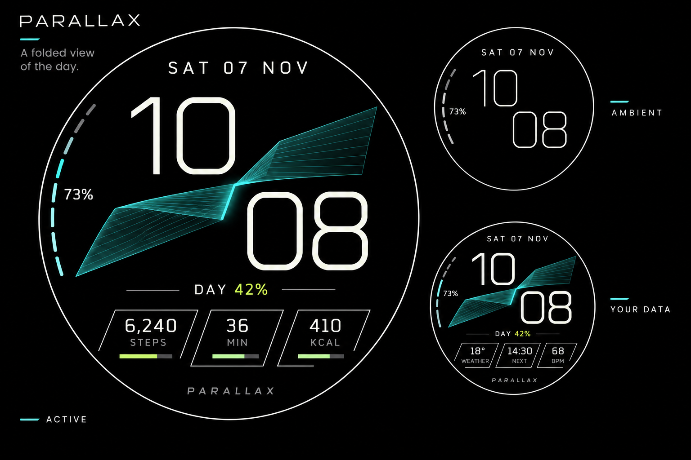

# PARALLAX

**Design approved for implementation, 2026-11-07. See [stage progress](progress.md).**

A folded view of the day: huge staggered numerals separated by a fine cyan
architectural fold, with three independently configurable data docks beneath.
The composition uses the round screen as an open field, with an asymmetric
diagonal through it. The fold is the signature of the face.

This board was made with the built-in imagegen tool after removing the previous
visual files. All displayed readings are illustrative. It is concept artwork,
not a device screenshot, a functioning face, or a pixel-perfect implementation
contract. The specifications below settle behavior and layout where artwork is
ambiguous. The [generation prompt](image-prompt.txt) is included for provenance.

## Composition

The hour sits high and left; the minute sits low and right. Both use the same
large ivory type size and remain uninterrupted by the fold. A compact date sits
above them. An interrupted battery rail occupies the inner left edge. Three
open-corner, slanted data docks occupy the lower third. A small day percentage
explains the geometry; PARALLAX appears quietly at the base.

The active view uses black negative space and hairline geometric surfaces. The
cyan belongs to the fold; lime belongs to current progress. Time retains the
strongest contrast. No texture or glow is required for meaning. The white circle
on the presentation board identifies the screen edge; the face will not draw a
bright perimeter circle in normal use.

| Token | Proposed value | Use |
| --- | --- | --- |
| OLED black | `#000000` | Entire background |
| Ivory | `#EDF2EA` | Time, primary values, date |
| Ion cyan | `#77F4E6` | Fold seam and battery rail |
| Acid lime | `#C9F279` | Day percentage and goal fills |
| Secondary | `#A0AAA6` | Data labels |
| Structural | `#34433F` | Quiet corners and unfilled rails |

Use narrow geometric time numerals with open counters, tabular widths, and a
fixed layout across all digit pairs. Proposed prototype typeface: system sans
light; custom typography is a later choice, subject to licensing and 1x reading
checks. Data values need a slightly heavier weight. Outline time is reserved for
ambient; if it reads poorly on hardware, use a thin solid alternate in the same
positions.

## Signature feature: the day fold

The fold makes a scalar quantity into a small architectural object. Two fine
ruled surfaces meet at a bright crease. As the local clock day progresses, the
crease travels along the lower-left to upper-right spine and the two surfaces
change their relative spans. The portion behind the crease becomes quieter;
the remaining portion retains faint cyan lines. The composition should resemble
a folded ribbon with depth while using economical native geometry.

`p = (24-hour hour * 60 + minute) / 1440`

At 10:08, `p` is 0.4222 and the small caption reads `DAY 42%`. At noon the crease
is halfway along its travel; near midnight it approaches the far tip. It resets
with the local calendar day. It reflects wall-clock position within a nominal
24-hour day. On daylight-saving changes it follows the skipped or repeated clock
hour, and travel updates it to the new local time. It does not measure elapsed
day duration, sunrise, health, or productivity.

Update geometry once per minute. There is no continuous idle motion, seconds
sweep, touch gesture, extra companion service, location requirement, or network
request for this feature. Turning the fold off leaves the time and data intact.
A clear percentage and a short editor explanation make its meaning discoverable.

## Layout and scale

Use a 450 by 450 logical canvas, center `(225,225)`, and keep essential content
inside radius 215. These are starting bounds for implementation, with final font
metrics and physical tap sizes verified on the target watch.

| Element | Proposed bounds / placement |
| --- | --- |
| Date | `(112,37)` to `(338,65)`, centered |
| Hour | Final text box `(98,67)` to `(254,193)`, 146-unit Rajdhani Light; actual glyphs sit inside the box |
| Minute | Final text box `(246,181)` to `(402,307)`, same type size |
| Fold field | Approx. `(44,90)` to `(398,287)`; black exclusion areas around both time boxes |
| Battery | Slim curved rail near left edge, approx. `(15,88)` to `(66,291)`; value near `(33,188)` |
| Day caption | Centered at `(225,304)`, approx. 15-unit type |
| Dock A / C | Visual centers `(119,342)` and `(331,342)` |
| Dock B | Visual center `(225,359)` |
| Dock content | Approx. 84 by 54 units per dock; values 22–25, labels 11–12 |
| Dock selection | Proposed circular bounds of diameter 104 around each center; pairwise non-overlapping |
| Signature | Centered at `(225,414)`, quiet small lettering; optional |

The data docks follow a shallow arc to use the round screen efficiently. Fold
lines must never cross the time glyphs or complication text. Selection bounds
contain the useful dock content and remain inside the circular display. Check
actual dp size and editor selection on hardware; widen targets or use two docks
on a small display if three cannot remain readable and selectable. Small-screen
accommodation is a test gate, not a claimed result.

## User-selected data and intrinsic data

| Area | Ownership | Supported content / proposed defaults |
| --- | --- | --- |
| Dock A | User configurable | Short text, ranged value, goal progress, monochrome icon, empty. Default: steps. |
| Dock B | User configurable | Same types. Default: active minutes from the existing companion, otherwise empty. |
| Dock C | User configurable | Same types. Default: active kcal from the existing companion, otherwise empty. |
| Time and date | Intrinsic | Device time format and local calendar; optional explicit 12/24-hour override |
| Battery rail + number | Intrinsic | Watch battery percentage; a small low-battery mark also distinguishes warning state without color |
| Day fold + percentage | Intrinsic | Local clock fields, computed on the face |

All three docks can be changed independently using the normal Wear OS
complication editor. Example alternatives include weather, an appointment,
heart rate, or another time zone when an installed provider supplies a compatible
type. Those example providers are not bundled or guaranteed. Heart rate must come
from the selected provider; the face adds no sensor sampling.

Value and title replace the initial labels when a provider changes. A WEATHER
dock cannot retain a STEPS label. Range fills appear only for valid typed numeric
progress; short text and icons have no invented progress bar. A provider icon
uses monochrome tinting. Large images and long text are outside the first
version's compact-dock scope. Long values shrink to a tested minimum and then
ellipsize; retain the provider's units and avoid invented numerical precision.

No provider selected: show a small plus in edit preview, quiet empty corners in
normal use. Selected provider without usable data: show a dash and no progress.
Do not insert sample readings. Tapping a populated dock uses the provider's tap
action when supplied; otherwise it does nothing. Long press opens the system
watch-face editor. The fold and battery have no gesture in version one.

The face works without companions: time, date, battery, and fold remain useful,
and each dock can use another installed provider or stay empty. The health bridge
adds optional data through its existing consent and expiry behavior.

## Display states and options

| State | Proposed behavior |
| --- | --- |
| Active | Full composition; fold changes once per minute; provider-driven values |
| Ambient | Same time positions, thin ivory numerals, compact date, battery number; omit fold, docks, rails, signature, and perimeter circle |
| Battery 20% or lower | Retain time, date, data; hide fold and show a battery warning mark |
| System power saving | Same simplified active treatment if the existing companion power signal is connected; ambient always stays sparse |
| Missing companion | No power-saving signal assumption; battery threshold still works and optional health docks stay empty |
| Unavailable data | Dash, no fill; expiry handled by the existing provider |
| 12-hour display | Unpadded hour with fixed-width alignment and small AM/PM marker in reserved space above the minute; fold still uses 24-hour time |
| Midnight / date change | Update date and fold together; show no prior-day activity after provider expiry |

Editor options: accent (cyan, cool white, restrained violet), fold on/off,
device/12/24-hour format, and small signature on/off. Keep slot configuration
in the system complication picker.

The proposed ambient target is below 10% illuminated pixels, with Google's 15%
limit as a release ceiling. Rendering, outline legibility, offload, and power
behavior still require device checks; no battery-life claim is made.

## Review and next step

The approved scope is this visual direction, the day-fold feature,
three replaceable docks, the ambient treatment, and the retained companion
architecture. Work follows the [implementation plan](implementation-plan.md).
Physical-watch installation and acceptance await watch availability.
