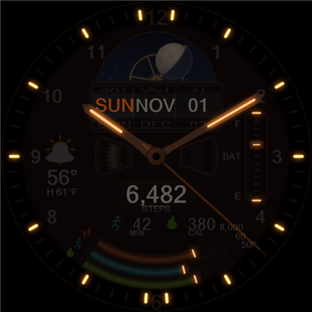

# Low-light dial

Emberphase Tritium 0.6.0 has a second look for dark rooms: a dimmer dial with
luminous tritium-style hands. It replaces the normal awake look when the
watch's screen brightness is set low, or when the editor option forces it.
Always-on mode is unchanged.

The preview is an illustrative composite, not a device screenshot.

## How it works

1. The Emberphase Health **watch companion** watches the watch's screen
   brightness setting. When the setting is at or below its low-light
   threshold, it reports 1; otherwise it reports 0. It publishes only when the
   state changes; there is no polling timer in the face.
2. The face receives that value through a hidden, non-customizable
   complication slot (slot 70, `brightness_state`, provider
   `com.bobbfwed.emberphase.health/com.bobbfwed.emberphase.health.watch.BrightnessDataSource`). It is an
   8 x 8 unit box on the dial at (400, 232), just below the power-saving slot,
   so the runtime keeps it active. It accepts only a `RANGED_VALUE` with a
   maximum of 1: a value above 0 means low light. Any other payload, an empty
   slot or a missing companion counts as normal.
3. The editor option **Low-light dial** decides what to do with that signal:

   | Option | Result |
   | --- | --- |
   | **Auto** (default) | Low-light when the companion reports 1, otherwise normal |
   | **Always normal** | Normal dial; the signal is ignored |
   | **Always low-light** | Low-light dial; works without the companion |

4. In low light the face:
   * draws the `lowlight_dial` overlay over the whole normal dial (moon
     window, balance, calendar, battery, weather or custom inset, activity
     numbers and tracks), under the hands. The overlay carries the glowing
     hour tubes and the glowing **F** and **E** battery markers;
   * draws, above the overlay, a glowing level line on the battery
     indicator (`lowlight_battery_slider`, moving with the indicator) and a
     glowing tube at the leading end of each activity track
     (`lowlight_track_edge`, shown whenever the track has data, at the start
     of the track when the value is zero);
   * replaces the hour and minute hands with the larger low-light tritium
     hands (same pivot at the dial centre);
   * keeps the mechanical second hand and its tick, drawn at 25% of its
     normal opacity;
   * swaps the centre cap for the low-light cap;
   * uses the low-light hands, and the dimmed second hand, during the
     six-second center-tap sweep.

Ambient (always-on) rendering ignores all of this: it shows the same ambient
dial and hands as before, whatever the option and signal.

Implementation notes: the slot exports `REFERENCE.low_light_signal`. The option
is read with native `ListConfiguration` branches, as the left inset is; the
Auto and Always low-light branches each export a flag, and a small source
group combines them into `REFERENCE.low_light` (1 or 0). Each hand set and
overlay is toggled by an alpha transform on that reference. None of these
sources is hidden in interactive mode. From 0.6.1 the glowing parts above the
overlay sit in one group, `lowlight_glow`: the level line uses the indicator's
own position expression (offset by its 10-unit bloom margin), and each track
end turns by `REFERENCE.<track>_fill_end`, which each track renderer exports
from the same expression that ends its fill.

## Limits

* **Auto needs the watch companion.** Without Emberphase Health on the watch,
  or if the companion does not list this face as allowed, Auto behaves as
  Always normal. Always low-light does not need the companion.
* **The threshold must be calibrated on the device.** The brightness setting's
  scale differs between watches and firmware. Check which setting levels the
  companion treats as low on the SM-R950 and adjust the companion's threshold
  if needed.
* **Adaptive (automatic) brightness** may change the effective screen
  brightness without changing the setting the companion reads; the face
  follows the companion's report, not a light sensor.
* **The signal may lag.** The face updates when the companion publishes and
  the system delivers the complication update. Expect a short delay after
  changing brightness. Like the other hidden slots, slot 70 is hidden in
  always-on mode, so the first frame after waking may briefly show the normal
  look before the signal is read again.
* **Always-on display is unchanged.**
* The overlay covers complication content. Anything that must stay readable
  in low light has to be left clear in the `lowlight_dial` artwork.

## Device test checklist

1. Install the face (0.6.0 or later) and the watch companion build that
   includes `BrightnessDataSource` and lists `com.bobbfwed.emberphase.tritium`
   as an allowed face. Add **Emberphase Tritium** and open its editor.
2. Confirm the editor shows **Low-light dial** with **Auto**, **Always
   normal** and **Always low-light**, and that Auto is the default.
3. **Always low-light**: the overlay, low-light hands, low-light cap and the
   dimmed second hand appear immediately. The **F** / **E** battery markers,
   the indicator's level line and the three track-end tubes glow; the level
   line and track ends sit exactly on the indicator and the fills. Check that
   weather, activity numbers and the date remain as legible as intended, and
   nothing is clipped.
4. **Always normal**: the normal dial and hands return, at any brightness.
5. **Auto**: lower the brightness setting step by step and note the level
   where the face switches to low light; raise it and note where it switches
   back. Record the delay. Adjust the companion threshold if the switch point
   is wrong.
6. Tap the centre hub in low light: the sweep uses the low-light hands, the
   dimmed second hand follows, and the face settles back to the low-light
   hands with no flash of the normal hands.
7. Let the watch enter always-on in both looks: always-on must be identical to
   the normal ambient face. Wake it and confirm the correct look returns.
8. Uninstall or disable the companion (or test on a watch without it) with
   Auto selected: the face must stay on the normal dial.
9. Check battery level cut-offs in low light: at 15% or less the second hand
   disappears, as on the normal dial.
