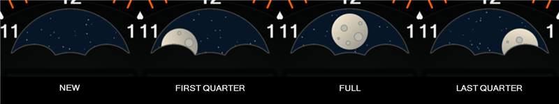

# Date-based mechanical moon phase

From 0.4.5, the face calculates the moon disc position locally from the current
date. It does not use a network API, GPS, or Wear OS's `MOON_PHASE_POSITION`.
The previous implementation used that coarse platform field and rotated the
disc in the opposite direction for waxing and waning.



The artwork remains a traditional twin-moon wheel moving behind a fixed,
scalloped aperture. Its visible outline is a stylized mechanical indication,
rather than an astronomical rendering of the lunar terminator. Waxing enters
from the left; waning exits to the right.

Version 0.4.7 widens the upper arch and centers its curvature on the wheel's
pivot. Its 87-unit radius clears the 55-unit orbit plus the moon's 26-unit
radius by six units. The scalloped lower edge still reveals the phase, while
the upper arch no longer clips the moon's outer rim near quarter phases. The
window's top stays at essentially the same height, clear of the hour markers
and calendar. This is a static artwork change with no additional updates.

## Calculation

The reference new moon is **2000-01-06 at 18:14 UTC**, from
[NASA's phase catalogue](https://eclipse.gsfc.nasa.gov/phase/phases1901.html).
The mean synodic month is **29.530588853 days**, consistent with the
[USNO Explanatory Supplement, chapter 15](https://aa.usno.navy.mil/downloads/c15_usb_online.pdf).

The WFF expression uses only `YEAR`, `DAY_OF_YEAR`, and `AMPM_STATE`, with UTC
and the Gregorian calendar explicitly set on the moon image. Gregorian leap-day
counts convert the date to days since 2000-01-01 without a millisecond timestamp:

```text
leapsBeforeYear(y) = floor((y-1)/4) - floor((y-1)/100) + floor((y-1)/400)
days = 365*(year-2000) + leapsBeforeYear(year) - 484 + dayOfYear - 1
sampleDays = days + 0.5*amPm + 0.25
lunations = (sampleDays - 5.7597222222) / 29.530588853
linearAngle = -90 + 180 * positiveModulo(lunations, 2)
discAngle = linearAngle + 7.5 * sin(2 * linearAngle * pi / 180)
```

Each half-day uses its midpoint, 06:00 or 18:00 UTC, limiting sampling error to
six hours. The input values change at **00:00 and 12:00 UTC**, so normal time
progression changes the position twice daily. They remain independent of local
time zones, daylight saving changes, and 12/24-hour display preferences.
The renderer may also reevaluate the expression when loading or waking the face;
there is no app timer, alarm, continuous animation, or background polling.

The disc carries two moons, so one full wheel revolution spans two lunations.
Modulo two keeps movement continuous when switching from one painted moon to
the next. At new moon the painted moon is hidden, and at full moon it is centered
in the window. The direction now agrees with waxing and waning.

The final small, periodic angle correction compensates for this artwork's
scalloped aperture. With uniform rotation, about 65% of the painted moon remains
visible at quarter phase. Moving that position from 45 to 52.5 degrees brings
the visible area close to half. The correction preserves new/full positions,
both painted moons, and continuous forward movement. It is an artwork
calibration, not an additional astronomical perturbation calculation.

## Accuracy and verification

This is a mean-cycle approximation, not a lunar ephemeris. Actual lunations and
the spacing between quarter phases vary. Tests compare 12 published 2026 events
from [USNO's phase table](https://aa.usno.navy.mil/calculated/moon/phases?date=2026-01-01&format=t&nump=50);
the largest equivalent phase-age error in those fixtures is **0.81 days**, including
half-day sampling. This is not a bound for every date. The expected phase in early
November 2026 is waning, following last quarter on November 1.

Tests also compare 4,384 half-day samples to an independent timestamp calculation
across years 1902, 1999, 2000, 2024, 2026, and 2100. They check leap years and
century rules, year rollover, cycle wrap, direction, and a fixed angle throughout
each half-day. No sub-hour time source or native moon field occurs in the moon
expression. Previews evaluate that same production expression for their fixture
date, rather than assuming a full moon.

`scripts/Test-MoonAperture.ps1` checks the generated dial's actual alpha mask:
117,836 interior moon-rim pixels clear the upper arch across both painted moons,
new/full positions have 0%/100% visibility, and calibrated quarter positions
have about 49.8% visibility each. This catches the earlier narrow-arch clipping
independently of the formula tests.
