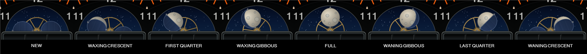

# Date-based mechanical moon phase

From 0.4.5, the face calculates the moon position locally from the current
date. It does not use a network API, GPS, or Wear OS's `MOON_PHASE_POSITION`.
The previous implementation used that coarse platform field and rotated the
disc in the opposite direction for waxing and waning.



From 0.6.0 (Emberphase Tritium), the moon window uses a geared two-moon carrier
with phase cups. The date calculation below is unchanged; only the mechanism
that displays it is new. It replaces the twin-moon disc behind a scalloped
aperture used up to 0.5.16.

## Mechanism and geometry

All coordinates are face units on the 450-unit dial.

| Part | Resource | Size | Placement |
| --- | --- | --- | --- |
| Sky (static) | `moon_sky` | 174 x 72 | x = 138, y = 46, drawn first |
| Carrier wheel with two moons | `moon_carrier` | 140 x 140 | x = 155, y = 46; pivot (225, 116) |
| Phase cups, one per moon | `moon_cup_00` ... `moon_cup_59` (no 30) | 58 x 58 | moon position, rotating with the carrier |

The carrier turns about its pivot at **(225, 116)**. Its two moons sit opposite
each other on a **38-unit** path radius, and each moon has a **26-unit**
radius. At carrier rotation 0 the top moon (moon 1) is centred at (225, 78) and
is the full moon; the bottom moon (moon 2) is hidden below the window by the
dial. The dial frame is drawn over the carrier, so the window shows only the
upper part of the moon path.

Each moon has its own cup group, rotated with the carrier: moon 1 by the
carrier angle and moon 2 by the carrier angle + 180 degrees. Inside the
140 x 140 group, a cup frame sits at x = 41, y = 3, so its centre (29, 29)
lands on the top-moon centre (70, 32). The frames are drawn for a moon at the
top and turn with it.

### Choosing a cup frame

For each moon, let *a* be its angle wrapped to within half a turn of the top:
0 is the top (full), negative angles are on the left (waxing, rising
clockwise), positive angles on the right (waning).

```text
if |a| >= 88.5: frame 00 (the cup covers the whole moon)
else: k = round((a + 90) / 3)
      k = 30: no cup (full)
      otherwise: frame moon_cup_k
```

Frame *k* is drawn for a moon angle of -90 + 3k degrees, so the cups change in
**3-degree steps**, roughly every half day. At new moon both moons are level
with the pivot and both show frame 00; at full moon one moon is at the top
with no cup. Only one moon is ever partly lit; the lower moon always has
frame 00. The carrier angle is exported once as `REFERENCE.moon_angle`, and two
small sources export the frame index of each moon. Each cup group selects its
frame with a WFF `Condition`, the same construct as the weather icons, so
only one image is drawn per moon.

The moon window is hidden in always-on mode. During the center-tap sweep the
carrier and its cups make one extra turn together and return to the live
position.

## Calculation

The reference new moon is **2000-01-06 at 18:14 UTC**, from
[NASA's phase catalogue](https://eclipse.gsfc.nasa.gov/phase/phases1901.html).
The mean synodic month is **29.530588853 days**, consistent with the
[USNO Explanatory Supplement, chapter 15](https://aa.usno.navy.mil/downloads/c15_usb_online.pdf).

The WFF expression uses only `YEAR`, `DAY_OF_YEAR`, and `AMPM_STATE`, with UTC
and the Gregorian calendar explicitly set on the moon image. Gregorian leap-day
counts convert the date to days since 2000-01-01 without a millisecond timestamp:

```text
leapsBeforeYear(y) = floor((y-1)/4) - floor((y-1)/100) + floor((y-1)/400)
days = 365*(year-2000) + leapsBeforeYear(year) - 484 + dayOfYear - 1
sampleDays = days + 0.5*amPm + 0.25
lunations = (sampleDays - 5.7597222222) / 29.530588853
carrierAngle = -90 + 180 * positiveModulo(lunations, 2)
```

Each half-day uses its midpoint, 06:00 or 18:00 UTC, limiting sampling error to
six hours. The input values change at **00:00 and 12:00 UTC**, so normal time
progression changes the position twice daily. They remain independent of local
time zones, daylight saving changes, and 12/24-hour display preferences.
The renderer may also reevaluate the expression when loading or waking the face;
there is no app timer, alarm, continuous animation, or background polling.

The carrier holds two moons, so one full revolution spans two lunations.
Modulo two keeps movement continuous when switching from one moon to the next.
At new moon (carrier angle -90 or +90) both moons are level with the pivot and
covered by their cups; at full moon (0 or 180) one moon is at the top with no
cup. Waxing rises on the left and waning sets on the right.

The carrier angle is linear in phase. For the moon in view, its angle from the
top is a = (p - 0.5) * 180 degrees, where p is the phase from 0 (new) to 1:
first quarter is exactly -45 degrees (frame 15) and last quarter +45 degrees
(frame 45). Each cup frame shows the lit fraction for its own angle; the
artwork applies no correction. Up to 0.5.16 the expression added a small
periodic term (7.5 * sin of twice the angle) to suit the old scalloped
aperture; 0.6.0 removes it.

## Accuracy and verification

This is a mean-cycle approximation, not a lunar ephemeris. Actual lunations and
the spacing between quarter phases vary. Tests compare 12 published 2026 events
from [USNO's phase table](https://aa.usno.navy.mil/calculated/moon/phases?date=2026-01-01&format=t&nump=50);
the largest equivalent phase-age error in those fixtures is **0.81 days**, including
half-day sampling. This is not a bound for every date. The expected phase in early
November 2026 is waning, following last quarter on November 1.

Tests also compare 4,384 half-day samples to an independent timestamp calculation
across years 1902, 1999, 2000, 2024, 2026, and 2100. They check leap years and
century rules, year rollover, cycle wrap, direction, and a fixed angle throughout
each half-day. No sub-hour time source or native moon field occurs in the moon
expression. Previews evaluate that same production expression for their fixture
date, rather than assuming a full moon.

The face tests also evaluate both moons' cup frames for every half-day in that
range. The frame is always a whole number from 0 to 59, a moon shows no cup
only within 1.5 degrees of full, the lower moon is always covered, and the two
moons are never both partly lit. At the 12 USNO fixtures in 2026, every moon
position is within one day (6.1 degrees, two cup steps) of the event:

| Event | Frames shown |
| --- | --- |
| Full moon (Oct 26, Nov 24) | 30 at the top, no cup |
| First quarter (Nov 17) | 15 on the left |
| Last quarter (Nov 1, Dec 1) | 43 on the right (the mean cycle is about 0.8 days behind these events) |
| New moon (7 events) | 00 on both moons, or 01 / 59 where the mean cycle is 0.6 to 0.7 days off |

`scripts/Test-MoonAperture.ps1` checks the generated artwork: every cup frame
from 00 to 59 except 30 exists, each frame's lit fraction of the moon matches
its phase, the new-moon position (each moon half inside the window) is fully
covered, and the lower half of the carrier stays hidden behind the dial.
